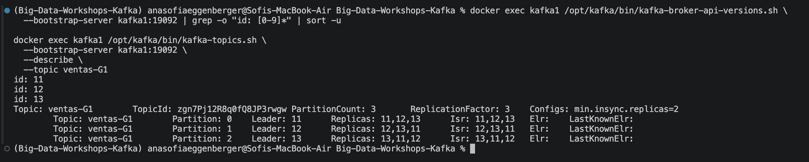
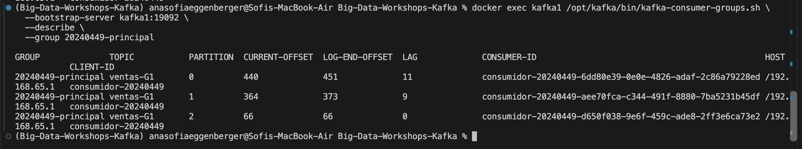
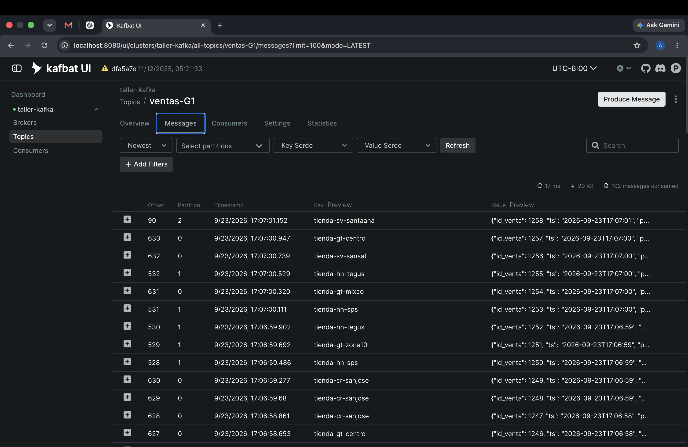
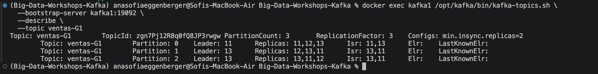
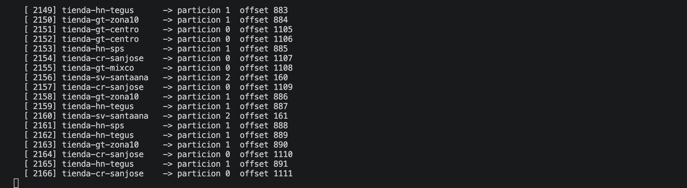
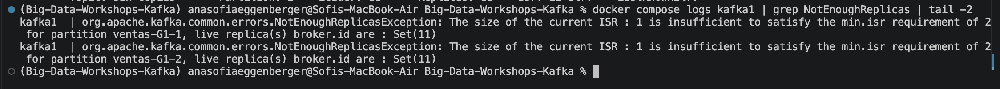
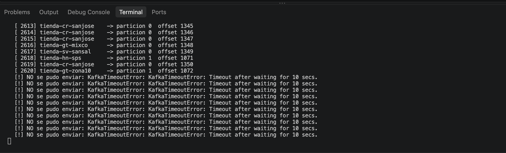
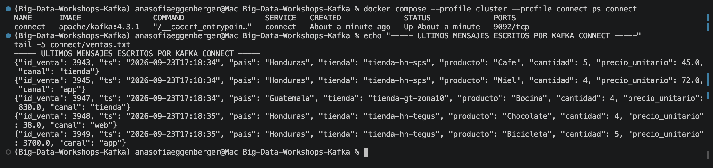

# Bitácora del taller de Kafka

- **Nombre:** Ana Sofía Eggenberger
- **Carné:** 20240449
- **Grupo:** G1
- **Enlace a tu video:** `video-demo.mp4` (en esta misma carpeta)

## 1. Evidencias

### E1. Los tres brokers y el detalle de tu topic (Pasos 6 y 7)



Lo que muestra: Se observan los tres brokers del clúster con IDs 11, 12 y 13. También se muestra el topic `ventas-G1` con 3 particiones, factor de replicación 3 y los tres brokers dentro del ISR.

### E2. La interfaz web con tu topic de ventas (Paso 8)



Lo que muestra: Se observa el topic `ventas-G1` desde la interfaz web de Kafka y los mensajes de ventas que estaban siendo producidos al topic.

### E3. Varios consumidores repartiéndose las particiones (Paso 8)



Lo que muestra: Se observa el grupo `20240449-principal` con varios consumidores repartiéndose las 3 particiones de `ventas-G1`. También se puede observar el LAG de las particiones.

### E4. Falla de un broker (Paso 9)





Lo que muestra: Al detener `kafka2`, el ISR bajó de tres réplicas a dos y una partición cambió de líder. A pesar de la falla, el productor pudo continuar enviando eventos porque todavía había dos réplicas sincronizadas.

### E5. Escrituras rechazadas (Paso 10)





Lo que muestra: Al detener también `kafka3`, quedó solamente una réplica dentro del ISR. Como `min.insync.replicas=2`, Kafka rechazó las escrituras y el productor terminó mostrando errores de timeout.

### E6. Kafka Connect escribiendo el archivo (Paso 11)



Lo que muestra: Se observa Kafka Connect ejecutándose y el `FileStreamSinkConnector` escribiendo los eventos de `ventas-G1` en el archivo `connect/ventas.txt`.

## 2. Preguntas

**1. ¿Qué guarda el controller y qué guarda cada broker? Justifícalo con lo que viste, y compáralo con el NameNode y los DataNodes del taller anterior.**

El controller administra la información del clúster, como los brokers, topics, particiones y sus líderes. Los brokers guardan los mensajes de las particiones que tienen asignadas. Esto se parece a HDFS: el NameNode administra los metadatos y los DataNodes guardan los datos reales.

**2. Con tu `--describe`: ¿cuántas particiones tiene tu topic, quién es líder de cada una y qué significa que el Isr tenga tres entradas?**

Mi topic `ventas-G1` tiene 3 particiones. Antes de las pruebas de falla, los líderes eran los brokers 11, 12 y 13 para las particiones 0, 1 y 2 respectivamente. Que el ISR tuviera tres entradas significaba que las tres réplicas estaban sincronizadas y disponibles.

**3. Produjiste con la tienda como clave. ¿Por qué una misma tienda cae siempre en la misma partición y qué garantía de orden te da eso? ¿Qué perderías si produjeras sin clave?**

La tienda se utilizó como clave, por lo que Kafka aplica el particionamiento de forma consistente y una misma tienda llega siempre a la misma partición. Esto permite conservar el orden de sus eventos. Sin clave, los eventos podrían distribuirse entre distintas particiones y se perdería ese orden por tienda.

**4. Corriste dos, tres y cuatro consumidores en el mismo grupo de lectura. ¿Qué pasó con el cuarto y por qué? ¿Qué cambió con un `--grupo-lectura` distinto?**

Como `ventas-G1` tiene 3 particiones, como máximo tres consumidores del mismo grupo pueden trabajar al mismo tiempo, uno por partición. Al agregar un cuarto consumidor quedó sin partición asignada. Con un `--grupo-lectura` distinto se crea otro grupo y este puede consumir los mismos mensajes de manera independiente.

**5. Al detener brokers, en un caso el productor siguió y en otro falló. Explica por qué, y relaciona `acks` y `min.insync.replicas` con la C y la A del teorema CAP.**

Al detener `kafka2` todavía quedaron dos réplicas en el ISR, así que se cumplía `min.insync.replicas=2` y el productor pudo seguir. Al detener también `kafka3` quedó una sola réplica y las escrituras fueron rechazadas. Con `acks=all`, Kafka priorizó la consistencia de los datos sobre aceptar nuevas escrituras, relacionándose con C sobre A durante esa falla.

**6. Sacaste los datos a un archivo con tu consumidor y con Kafka Connect. ¿Qué tuviste que resolver para que Connect funcionara, y en qué caso real preferirías cada forma?**

Para Connect tuve que configurar el `FileStreamSinkConnector`, el topic `ventas-G1`, los converters y el archivo de salida, además de montar la carpeta para poder ver `ventas.txt` desde mi computadora. Usaría un consumidor propio cuando necesito lógica personalizada y Connect cuando solo necesito mover datos de Kafka hacia otro sistema de forma automática.

## 3. Mini-reto de tu grupo

**Pregunta asignada a tu grupo:**

¿Qué país tiene el mayor monto total de ventas (`cantidad * precio_unitario`)? Mostrar el total de cada país ordenado de mayor a menor.

**Tu programa** (también va como `mini-reto.py`):

```python
import json

totales = {}

with open("salida/ventas-G1.jsonl", "r") as archivo:
    for linea in archivo:
        venta = json.loads(linea)

        pais = venta["pais"]
        total_venta = venta["cantidad"] * venta["precio_unitario"]

        if pais not in totales:
            totales[pais] = 0

        totales[pais] += total_venta

ordenados = sorted(totales.items(), key=lambda x: x[1], reverse=True)

print("Total de ventas por pais:")
for pais, total in ordenados:
    print(f"{pais}: {total:.2f}")

print(f"\nPais con mayor monto de ventas: {ordenados[0][0]}")
print(f"Total: {ordenados[0][1]:.2f}")
```

**Resultado de tu programa** — la salida tal como la imprimió, y también la línea del `wc -l`:

```text
Total de ventas por pais:
Guatemala: 1413807.00
Honduras: 1199651.00
Costa Rica: 920581.00
El Salvador: 579114.00

Pais con mayor monto de ventas: Guatemala
Total: 1413807.00

2000 salida/ventas-G1.jsonl
```

**Interpretación en una frase:**

Guatemala fue el país con el mayor monto total de ventas, con Q1,413,807.00 acumulados en los 2,000 eventos analizados.

## 4. Problemas encontrados (opcional)

Al configurar Kafka Connect inicialmente fue necesario ajustar los perfiles de Docker Compose porque Connect dependía de los brokers `kafka2` y `kafka3`. Se resolvió levantándolo junto con los perfiles `cluster` y `connect`, y finalmente el conector pudo escribir correctamente los eventos en `ventas.txt`.
