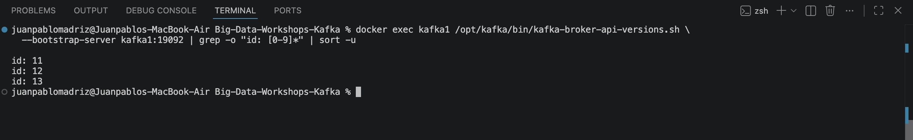
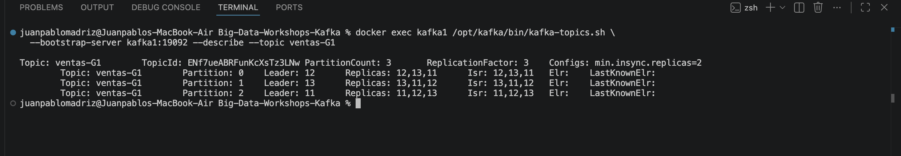
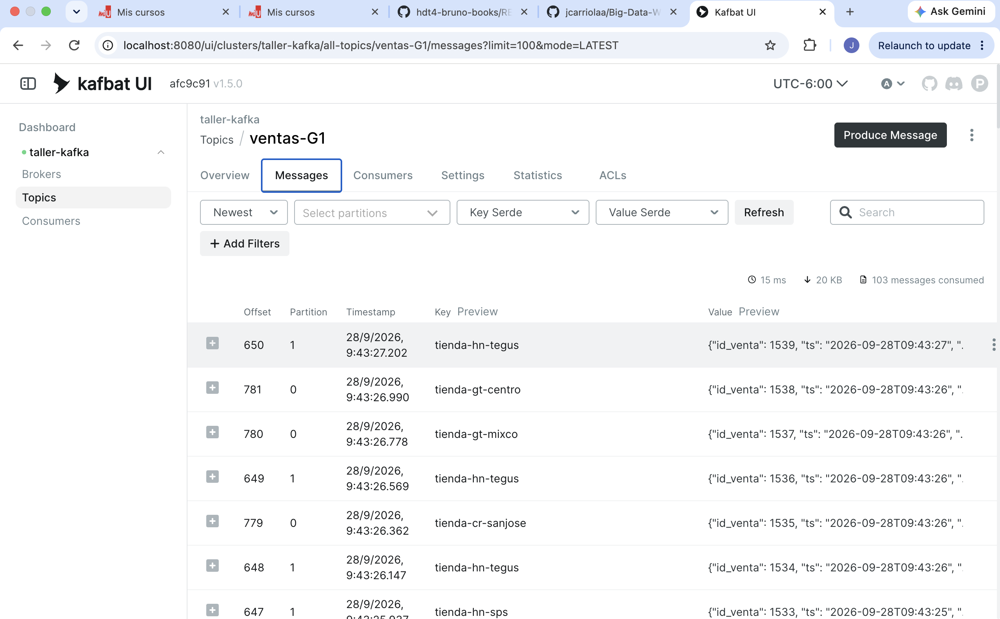
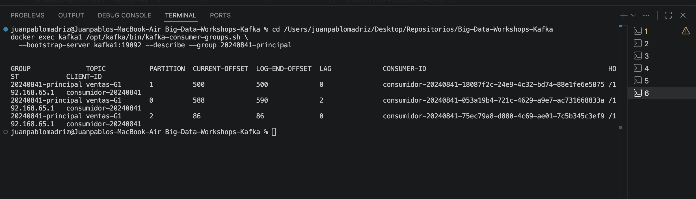
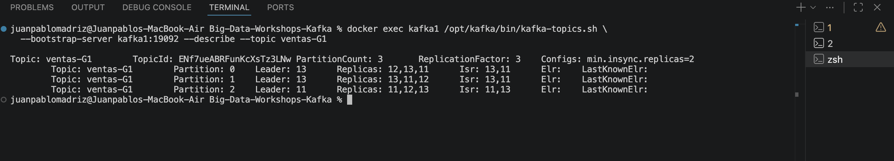
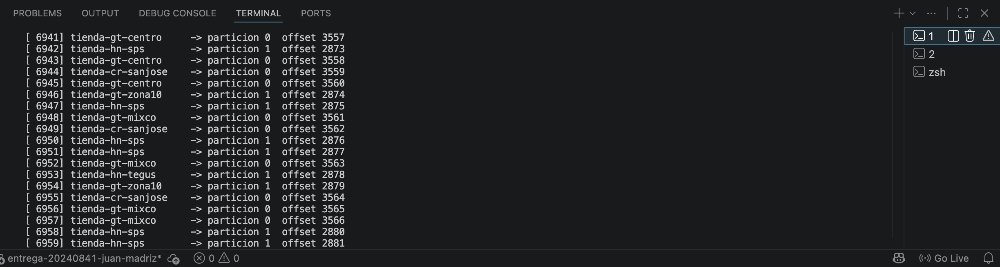
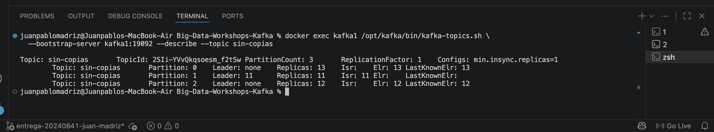
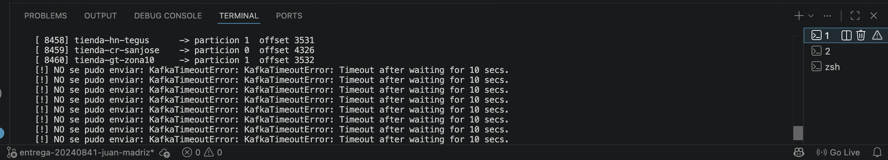
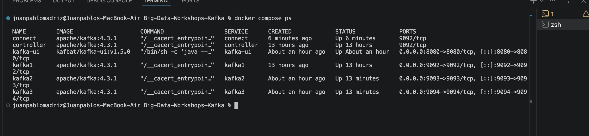
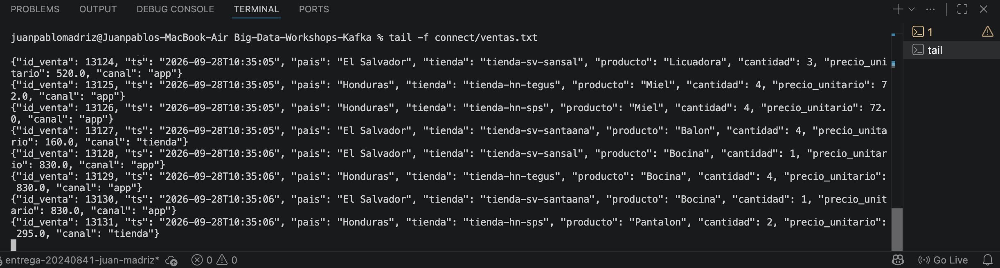

# Bitácora del taller de Kafka

- **Nombre:** Juan Pablo Madriz
- **Carné:** 20240841
- **Grupo:** G1
- **Enlace a tu video:** `video-demo.mp4` (en esta misma carpeta)

## 1. Evidencias

### E1. Los tres brokers y el detalle de tu topic (Pasos 6 y 7)





Lo que muestra: los tres brokers de mi clúster registrados con los ids 11, 12 y 13, y el detalle de
mi topic `ventas-G1` con 3 particiones, factor de replicación 3 y `min.insync.replicas=2`. Los
liderazgos quedaron repartidos: la partición 0 la lidera el broker 12, la 1 el 13 y la 2 el 11.

### E2. La interfaz web con tu topic de ventas (Paso 8)



Lo que muestra: la interfaz Kafbat UI que agregué al `compose.yml`, abierta en mi topic `ventas-G1`
en la pestaña Messages. Se ven los mensajes con su offset, su partición y la tienda como clave.

### E3. Varios consumidores repartiéndose las particiones (Paso 8)



Lo que muestra: el grupo `20240841-principal` con tres `CONSUMER-ID` distintos, cada uno leyendo una
partición, y la columna `LAG` con lo que le falta por leer a cada uno.

### E4. Falla de un broker (Paso 9)





Lo que muestra: con `kafka2` detenido, el `Isr` bajó a dos copias (`11,13`) y la partición que
lideraba el broker 12 pasó a otro líder. Al mismo tiempo mi productor sigue publicando sin un solo
error.

### E5. Escrituras rechazadas (Paso 10)





Lo que muestra: el topic `sin-copias` con dos particiones en `Leader: none` porque vivían en los
brokers que apagué y no tenían copia. Y mi productor fallando con `KafkaTimeoutError` al quedar una
sola copia al día en `ventas-G1`.

### E6. Kafka Connect escribiendo el archivo (Paso 11)





Lo que muestra: el servicio `connect` corriendo junto a los otros cinco contenedores, y el archivo
`connect/ventas.txt` creciendo en tiempo real con un evento JSON por línea.

## 2. Preguntas

**1. ¿Qué guarda el controller y qué guarda cada broker? Justifícalo con lo que viste, y compáralo con el NameNode y los DataNodes del taller anterior.**

Cuando comparé los dos discos vi la diferencia clarísima. En `controller` solo hay tres cosas:
`__cluster_metadata-0`, `bootstrap.checkpoint` y `meta.properties`. En `kafka1` están esas mismas más
seis carpetas de partición: `tiendas-G1-0/1/2` y `ventas-G1-0/1/2`. O sea que el controller lleva el
inventario del clúster (qué topics existen, cuántas particiones, quién lidera cada una) y no guarda
ni un mensaje, mientras los brokers son los que tienen los datos en disco. Es lo mismo que en Hadoop:
el controller hace de NameNode, que guardaba el árbol de archivos pero no los bloques, y los brokers
hacen de DataNodes, que guardaban los bloques.

**2. Con tu `--describe`: ¿cuántas particiones tiene tu topic, quién es líder de cada una y qué significa que el Isr tenga tres entradas?**

Mi topic `ventas-G1` tiene 3 particiones con factor de replicación 3. Kafka repartió los liderazgos
uno por broker: la partición 0 la lidera el broker 12, la 1 el 13 y la 2 el 11. El líder es el que
atiende todas las lecturas y escrituras de esa partición. Que el `Isr` tenga tres entradas
(`11,12,13`) significa que las tres copias están al día en ese momento, no solo que existen. La
diferencia se vio cuando apagué `kafka2`: `Replicas` siguió diciendo `12,13,11` porque la asignación
no cambia, pero el `Isr` bajó a `11,13`.

**3. Produjiste con la tienda como clave. ¿Por qué una misma tienda cae siempre en la misma partición y qué garantía de orden te da eso? ¿Qué perderías si produjeras sin clave?**

Porque Kafka saca un hash de la clave y con ese número decide la partición. Como la clave es la
tienda, el hash siempre es el mismo y la tienda siempre cae en el mismo lugar. Eso me da orden
garantizado dentro de esa tienda, porque Kafka respeta el orden dentro de una partición. Se notó en
lo desparejo del reparto: la partición 0 llegó al offset 7033 y la 2 apenas a 964, porque la 2 solo
recibe `tienda-sv-santaana` y la 0 recibe cuatro tiendas. Sin clave los mensajes se repartirían
parejo pero perdería el orden por tienda: dos ventas de la misma tienda podrían caer en particiones
distintas y leerse al revés.

**4. Corriste dos, tres y cuatro consumidores en el mismo grupo de lectura. ¿Qué pasó con el cuarto y por qué? ¿Qué cambió con un `--grupo-lectura` distinto?**

El cuarto consumidor no recibió ni un mensaje. Se quedó conectado pero sin nada que leer, porque cada
partición la lee uno solo del grupo y mi topic tiene 3 particiones: con cuatro consumidores uno sobra.
En el `--describe` del grupo `20240841-principal` se ve exactamente eso, solo tres `CONSUMER-ID`
asignados. Cada vez que entraba uno nuevo hubo rebalanceo. Con `--grupo-lectura auditoria` cambió
todo: al ser otro grupo empezó a leer desde el primer mensaje y no le quitó particiones a los otros,
porque cada grupo lleva sus propios offsets.

**5. Al detener brokers, en un caso el productor siguió y en otro falló. Explica por qué, y relaciona `acks` y `min.insync.replicas` con la C y la A del teorema CAP.**

Con `kafka2` apagado el `Isr` quedó en 2 (`11,13`) y mi topic pide `min.insync.replicas=2`. Justo
alcanzaba, así que siguió escribiendo: los offsets pasaron de 1520 a 1683 con el broker caído. Al
apagar también `kafka3` el `Isr` bajó a 1 (solo `11`) y ahí empezó el `KafkaTimeoutError`. Lo curioso
es que `kafka1` estaba vivo y era líder de las tres particiones, o sea que podía escribir, pero no
quiso. En el log del broker está la razón: `NotEnoughReplicasException: The size of the current ISR :
1 is insufficient to satisfy the min.isr requirement of 2`. Eso pasa porque mi productor usa
`acks="all"` y esa configuración solo aplica junto con `min.insync.replicas`. Kafka podía aceptar y
seguir disponible, que es la A de CAP, o rechazar para no guardar nada sin respaldo, que es la C.
Escogió la C porque así está configurado, no porque se rompiera: si le bajo el `min.insync.replicas`
a 1 o pongo `acks=1`, el mismo clúster con la misma caída acepta.

**6. Sacaste los datos a un archivo con tu consumidor y con Kafka Connect. ¿Qué tuviste que resolver para que Connect funcionara, y en qué caso real preferirías cada forma?**

Tuve que resolver cuatro cosas. Primero, el servicio: usé la misma imagen de Kafka pero hay que
sobreescribir el `command`, porque el de la imagen arranca un broker en vez de Connect. Segundo, la
conexión: como Connect corre dentro de Docker tiene que apuntar a `kafka1:19092` y no a `localhost`,
que para él sería su propio contenedor. Tercero, el formato: el converter por defecto espera un sobre
con `schema` y `payload`, y mi productor manda JSON plano, así que usé `StringConverter` para que
pase los bytes tal cual. Cuarto, el conector: el JAR de FileStream viene en `/opt/kafka/libs` pero
Connect solo busca conectores en `plugin.path`, así que hay que copiarlo a una carpeta aparte.
Usaría Connect cuando solo hay que mover datos de un lado a otro, porque no hay código que mantener y
la configuración se versiona. Usaría un programa propio cuando hay que transformar o filtrar en el
camino, como hice en el mini-reto, donde tengo que multiplicar y agrupar.

## 3. Mini-reto de tu grupo

**Pregunta asignada a tu grupo:** ¿Qué país concentra más ventas en dinero
(`cantidad × precio_unitario`)? Total de cada país, de mayor a menor.

**Tu programa** (también va como `mini-reto.py`):

```python
#!/usr/bin/env python3
"""Mini-reto G1: que pais concentra mas ventas en dinero.

Lee salida/ventas-G1.jsonl (un evento JSON por linea) y suma
cantidad * precio_unitario por pais.
"""
import json

ARCHIVO = "salida/ventas-G1.jsonl"


def main():
    total_por_pais = {}
    ventas_por_pais = {}

    with open(ARCHIVO, encoding="utf-8") as f:
        for linea in f:
            evento = json.loads(linea)
            pais = evento["pais"]
            monto = evento["cantidad"] * evento["precio_unitario"]
            # setdefault evita tener que inicializar cada pais a mano
            total_por_pais[pais] = total_por_pais.get(pais, 0) + monto
            ventas_por_pais[pais] = ventas_por_pais.get(pais, 0) + 1

    # De mayor a menor, que es como lo pide el enunciado.
    orden = sorted(total_por_pais.items(), key=lambda par: par[1], reverse=True)

    total_general = sum(total_por_pais.values())
    eventos = sum(ventas_por_pais.values())

    print(f"Ventas en dinero por pais ({eventos} eventos)\n")
    print(f"{'Pais':<15} {'Total':>14} {'Ventas':>8} {'% del total':>12}")
    print("-" * 52)
    for pais, total in orden:
        pct = total / total_general * 100
        print(f"{pais:<15} {total:>14,.2f} {ventas_por_pais[pais]:>8} {pct:>11.1f}%")
    print("-" * 52)
    print(f"{'TOTAL':<15} {total_general:>14,.2f} {eventos:>8}")

    ganador, monto_ganador = orden[0]
    print(f"\nEl pais que mas vende en dinero es {ganador}, "
          f"con {monto_ganador:,.2f} de {total_general:,.2f} en total "
          f"({monto_ganador / total_general * 100:.1f}%).")


if __name__ == "__main__":
    main()
```

**Resultado de tu programa** — la salida tal como la imprimió, y también la línea del `wc -l`:

```
$ wc -l salida/ventas-G1.jsonl
    2000 salida/ventas-G1.jsonl

$ python3 mini-reto.py
Ventas en dinero por pais (2000 eventos)

Pais                     Total   Ventas  % del total
----------------------------------------------------
Guatemala         1,413,807.00      688        34.4%
Honduras          1,199,651.00      596        29.2%
Costa Rica          920,581.00      424        22.4%
El Salvador         579,114.00      292        14.1%
----------------------------------------------------
TOTAL             4,113,153.00     2000

El pais que mas vende en dinero es Guatemala, con 1,413,807.00 de 4,113,153.00 en total (34.4%).
```

**Interpretación en una frase:** Guatemala concentra el 34.4 % del dinero vendido, pero gana por
volumen y no por ticket: hizo 688 de las 2000 ventas, mientras que Costa Rica con apenas 424 ventas
llegó a 920,581, o sea un promedio por venta bastante más alto.

## 4. Problemas encontrados

Al crear el topic `ventas-G1` corrí el `--describe` antes del `--create` y me salió
`Topic 'ventas-G1' does not exist as expected`. No era problema del clúster: el topic simplemente no
existía todavía, porque `--describe` solo lee y no crea nada.

El video me salió de 268 MB porque grabé en Retina a 60 fps, y el límite es 50 MB. Lo comprimí con
`ffmpeg` bajando a 1920 px de ancho y 15 fps, y quedó en 15.6 MB sin perder legibilidad del texto de
la terminal, que es lo que importa.
