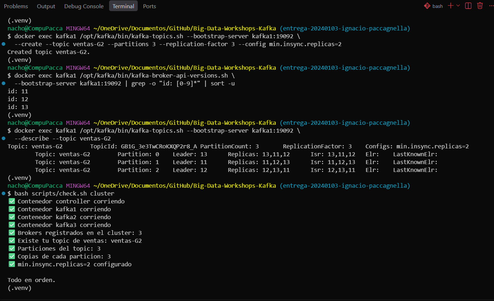
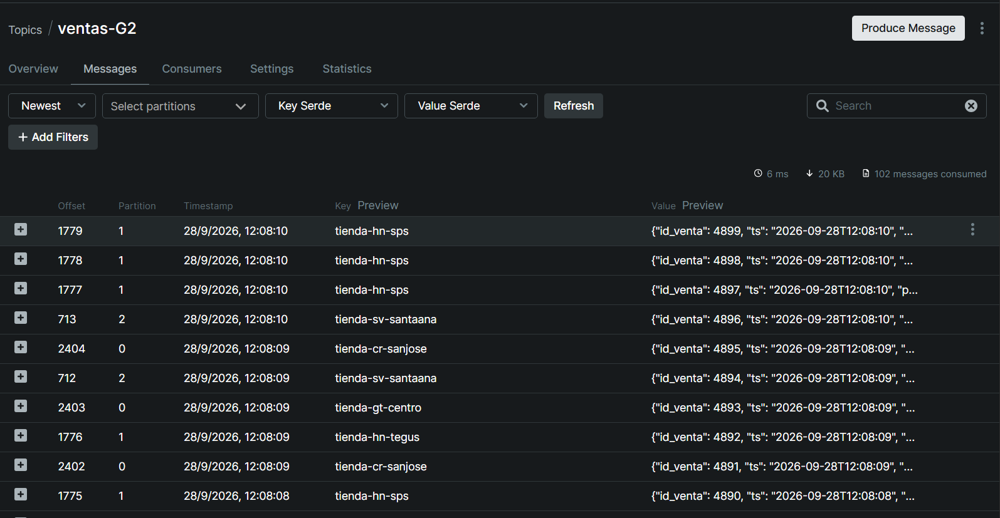
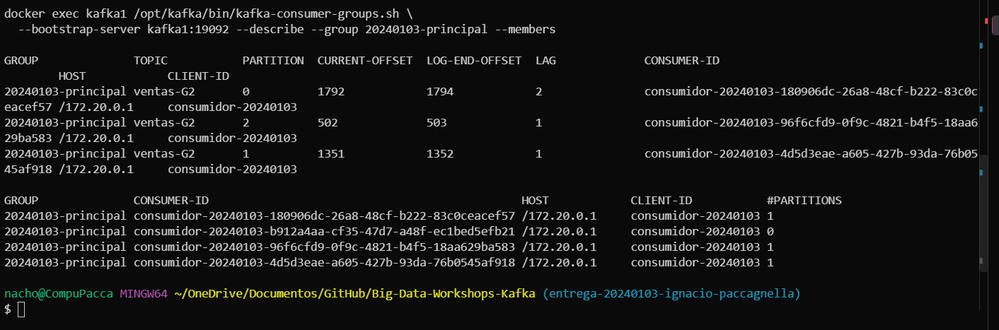
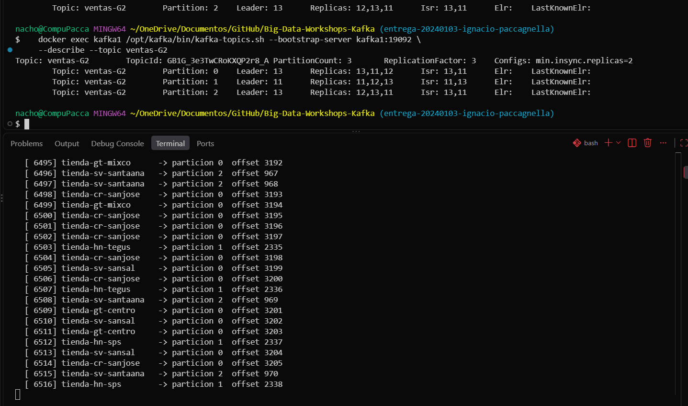
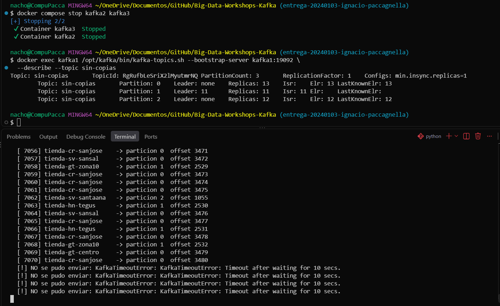

# Bitácora del taller de Kafka

- **Nombre:** Ignacio Paccagnella
- **Carné:** 20240103
- **Grupo:** G2
- **Enlace a tu video:** `video-demo.mp4` (en esta misma carpeta)

## 1. Evidencias

### E1. Los tres brokers y el detalle de tu topic (Pasos 6 y 7)



Lo que muestra: los tres ids de broker (11, 12 y 13) y el `--describe` de `ventas-G2`, con 3 particiones, `ReplicationFactor: 3`, `min.insync.replicas=2` y el `Isr` completo (11,12,13) en cada partición.

### E2. La interfaz web con tu topic de ventas (Paso 8)



Lo que muestra: la interfaz web (kafbat) con el topic `ventas-G2` abierto en la pestaña Messages, con ventas de las particiones 0, 1 y 2 y sus tiendas como clave.

### E3. Varios consumidores repartiéndose las particiones (Paso 8)



Lo que muestra: el `--describe` del grupo `20240103-principal`, con un `CONSUMER-ID` distinto por cada partición y la columna `LAG` con los mensajes pendientes de cada una.

### E4. Falla de un broker (Paso 9)



Lo que muestra: con `kafka2` (broker 12) detenido, el `Isr` bajó a dos brokers en las tres particiones y mi productor siguió publicando ventas sin errores.

### E5. Escrituras rechazadas (Paso 10)



Lo que muestra: con `kafka2` y `kafka3` detenidos, el topic `sin-copias` tiene `Leader: none` en las particiones 0 y 2, y mi productor falla con `KafkaTimeoutError` porque solo queda una copia al día.

### E6. Kafka Connect escribiendo el archivo (Paso 11)


Lo que muestra: el contenedor `connect` en `Up` y el `tail` de `connect/ventas.txt` con eventos de `ventas-G2` (`id_venta` 9487 a 9496) escritos sin programar nada.

## 2. Preguntas

**1. ¿Qué guarda el controller y qué guarda cada broker? Justifícalo con lo que viste, y compáralo con el NameNode y los DataNodes del taller anterior.**

El controller solo guarda metadatos: qué topics existen, cuántas particiones tiene cada uno y quién es líder de cada una. En mi compose corre con rol controller y no publica puerto. Los brokers (11, 12 y 13) son los que guardan los mensajes reales, en una carpeta por partición dentro de /var/lib/kafka/data, como ventas-G2-0. Es el mismo esquema que en Hadoop: el controller es el NameNode con el índice, y los brokers son los DataNodes con los datos.

**2. Con tu `--describe`: ¿cuántas particiones tiene tu topic, quién es líder de cada una y qué significa que el Isr tenga tres entradas?**

Mi topic ventas-G2 tiene 3 particiones. La 0 tiene como líder al broker 13, la 1 al 11 y la 2 al 12. Que el Isr sea 11,12,13 significa que las tres copias de cada partición están sincronizadas con su líder. Si un broker se cae, cualquiera de los otros dos ya tiene todo al día y puede tomar el liderazgo sin perder mensajes.

**3. Produjiste con la tienda como clave. ¿Por qué una misma tienda cae siempre en la misma partición y qué garantía de orden te da eso? ¿Qué perderías si produjeras sin clave?**

Kafka calcula la partición con un hash de la clave, así que mientras el topic tenga 3 particiones, la misma tienda cae siempre en la misma. En mi caso, tienda-sv-santaana siempre cayó en la partición 2 y tienda-gt-mixco en la 0. Como Kafka solo garantiza orden dentro de una partición, las ventas de cada tienda llegan en el orden en que ocurrieron. Sin clave, los mensajes se repartirían al azar y ese orden se perdería.

**4. Corriste dos, tres y cuatro consumidores en el mismo grupo de lectura. ¿Qué pasó con el cuarto y por qué? ¿Qué cambió con un `--grupo-lectura` distinto?**

Con cuatro consumidores en el grupo 20240103-principal, el --members mostraba a los cuatro, pero solo tres tenían partición asignada. El consumidor b912a4aa quedó con #PARTITIONS en 0, porque solo hay 3 particiones y cada una la lee un único consumidor del grupo. Con un --grupo-lectura distinto (auditoria) se formó un grupo nuevo con sus propios offsets, y ese consumidor leyó el topic completo desde el inicio, los 2388 mensajes, sin afectar al grupo principal.

**5. Al detener brokers, en un caso el productor siguió y en otro falló. Explica por qué, y relaciona `acks` y `min.insync.replicas` con la C y la A del teorema CAP.**

Al detener kafka2, el Isr bajó de tres a dos y la partición 2 cambió de líder, del 12 al 13. El productor siguió sin errores porque quedaban dos copias al día, el mínimo que pide min.insync.replicas=2. Al detener también kafka3, solo quedó kafka1 con un Isr de uno, por debajo del mínimo. Con acks=all el productor empezó a fallar con KafkaTimeoutError después de la venta 7070. Ahí Kafka priorizó la Consistencia sobre la Disponibilidad. Con otro acks o un min.insync.replicas menor, habría seguido aceptando mensajes, sacrificando la Consistencia por la Disponibilidad.

**6. Sacaste los datos a un archivo con tu consumidor y con Kafka Connect. ¿Qué tuviste que resolver para que Connect funcionara, y en qué caso real preferirías cada forma?**

Para Connect tuve que resolver tres cosas: usar la dirección interna de los brokers (kafka1:19092), porque corre dentro de Docker; poner value.converter.schemas.enable=false, porque mi productor manda JSON plano; y configurar bien el plugin.path para que encontrara el JAR de FileStreamSink. Connect escribió los eventos como tienda=..., cantidad=..., no como JSON, así que sirve para mover datos de A a B sin mantener código propio. Mi consumidor lo preferiría cuando hay que transformar, filtrar o decidir algo sobre los datos en el camino.
**3. Produjiste con la tienda como clave. ¿Por qué una misma tienda cae siempre en la misma partición y qué garantía de orden te da eso? ¿Qué perderías si produjeras sin clave?**

Esto pasa porque Kafka calcula la partición aplicando un hash sobre la clave, entonces mientras el topic siga teniendo 3 particiones, la misma tienda va a caer siempre en la misma. En mi caso, tienda-sv-santaana cayó todo el tiempo en la partición 2 y tienda-gt-mixco en la 0. Y como Kafka solo garantiza el orden dentro de una misma partición, esto significa que las ventas de cada tienda me llegan siempre en el orden en que ocurrieron. Si hubiera producido sin clave, los mensajes se habrían repartido de forma aleatoria entre las particiones, y ahí sí las ventas de una misma tienda podrían terminar leyéndose desordenadas.

**4. Corriste dos, tres y cuatro consumidores en el mismo grupo de lectura. ¿Qué pasó con el cuarto y por qué? ¿Qué cambió con un `--grupo-lectura` distinto?**

Cuando metí cuatro consumidores al grupo 20240103-principal, el --members sí mostraba a los cuatro como parte del grupo, pero solo tres terminaron con una partición asignada. Al cuarto, identificado como b912a4aa, le tocó quedarse con #PARTITIONS en 0, literalmente sin nada que hacer. Tiene sentido porque solo hay 3 particiones y cada una la puede leer un único consumidor dentro del grupo, así que el que sobra simplemente se queda esperando. Ahora, cuando usé un --grupo-lectura distinto (auditoria), Kafka armó un grupo completamente nuevo con sus propios offsets, y ese consumidor pudo leer el topic entero desde el principio, los 2388 mensajes, sin tocar para nada al grupo principal.

**5. Al detener brokers, en un caso el productor siguió y en otro falló. Explica por qué, y relaciona `acks` y `min.insync.replicas` con la C y la A del teorema CAP.**

Cuando detuve kafka2, el Isr bajó de tres a dos (13,11 y 11,13) y la partición 2 cambió de líder, pasando del 12 al 13. Aun así el productor siguió funcionando sin errores, porque todavía quedaban dos copias sincronizadas, justo el mínimo que pide min.insync.replicas=2. El problema vino cuando además de kafka2 apagué kafka3: ahí solo quedó kafka1 en pie, con un Isr de una sola entrada, por debajo del mínimo exigido. Con acks=all configurado, el productor empezó a tirar KafkaTimeoutError justo después de la venta 7070. En ese momento Kafka decidió priorizar la Consistencia por encima de la Disponibilidad: prefirió no guardar nada sin respaldo suficiente antes que seguir aceptando escrituras a ciegas. Si hubiera usado otro valor de acks o bajado el min.insync.replicas, el sistema habría seguido aceptando mensajes sin problema, pero ahí ya estaría sacrificando la Consistencia a favor de la Disponibilidad.

**6. Sacaste los datos a un archivo con tu consumidor y con Kafka Connect. ¿Qué tuviste que resolver para que Connect funcionara, y en qué caso real preferirías cada forma?**

Para que Connect arrancara tuve que resolver tres cosas puntuales. Primero, usar la dirección interna de los brokers (kafka1:19092), porque Connect corre adentro de la red de Docker y no puede verlos desde afuera. Segundo, poner value.converter.schemas.enable=false, porque mi productor manda JSON plano sin ningún esquema definido. Y tercero, configurar bien el plugin.path para que Connect lograra encontrar el JAR del conector FileStreamSink. Al final, Connect terminó escribiendo los eventos en un formato tipo tienda=..., cantidad=... en vez de JSON de verdad, así que me parece que sirve bien para casos donde solo necesitás mover datos de un punto A a un punto B sin tener que mantener código propio. En cambio, mi consumidor propio lo preferiría en casos donde haya que transformar, filtrar o decidir algo sobre los datos en el camino, cosas que Connect no hace por sí solo.

## 3. Mini-reto de tu grupo

**Pregunta asignada a tu grupo:**

G2: ¿Cuáles son los 5 productos con más unidades vendidas? ¿Cuántas vendió el primero?

**Tu programa** (también va como `mini-reto.py`):

```python
import json
from collections import Counter

unidades = Counter()
with open("salida/ventas-G2.jsonl", encoding="utf-8") as archivo:
    for linea in archivo:
        evento = json.loads(linea)
        unidades[evento["producto"]] += evento["cantidad"]

for producto, total in unidades.most_common(5):
    print(producto, total)
```

**Resultado de tu programa** — la salida tal como la imprimió, y también la línea del `wc -l`:

```
Zapatos 665
Cafe 636
Licuadora 633
Balon 629
Bicicleta 608

```

**Interpretación en una frase:**
El producto más vendido en unidades fue zapatos, con 665 unidades sobre los 2000 eventos de mi grupo.


## 4. Problemas encontrados (opcional)

- En la Parte 1, con un solo broker, mi productor y mi consumidor de Python daban `KafkaTimeoutError`. Comprobé que el broker y el puerto 9092 funcionaban, y que fallaba la lista de tres brokers (9092, 9093 y 9094). Se resolvió al levantar `kafka2` y `kafka3` en la Parte 2.
- Al pegar `kafka-ui` y `connect` en el `compose.yml` quedaron con demasiada sangría y Docker los tomó como propiedades de `kafka3`. Lo corregí alineándolos con 2 espacios y validé con `docker compose config -q`.
- En Git Bash de Windows el comando es `python` y no `python3`, así que usé `python` en todos los comandos.