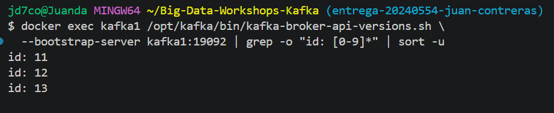
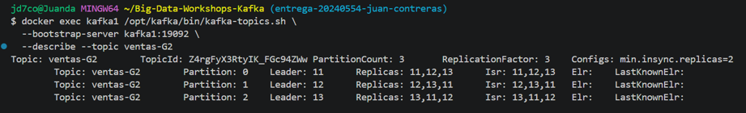
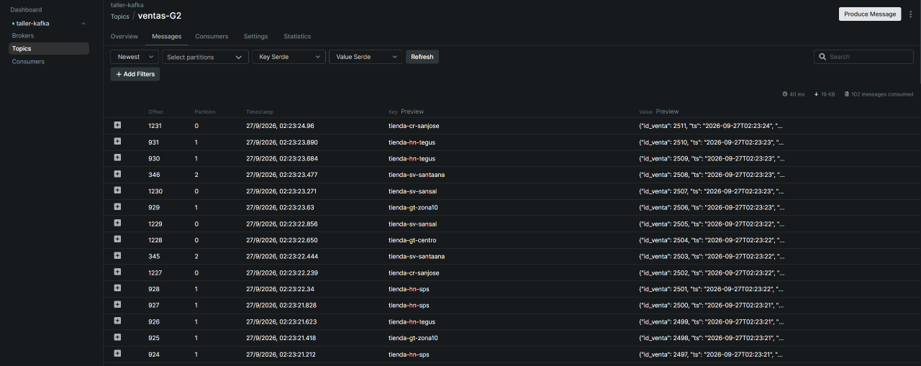
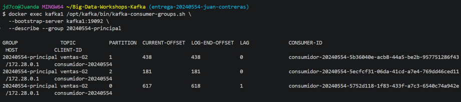
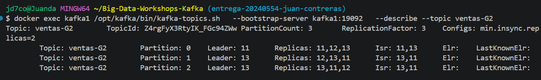
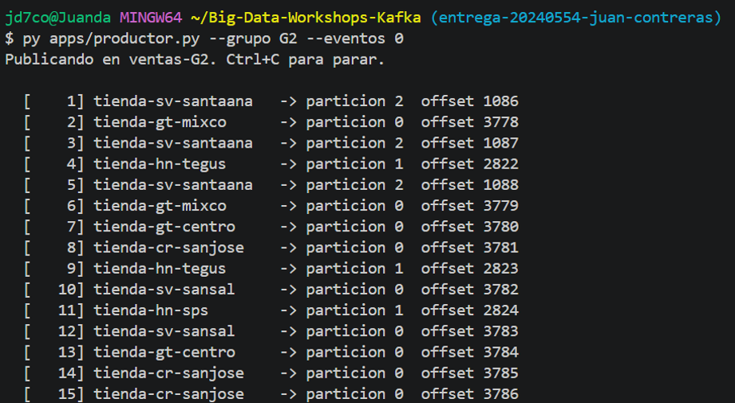
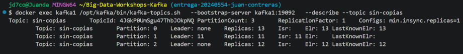
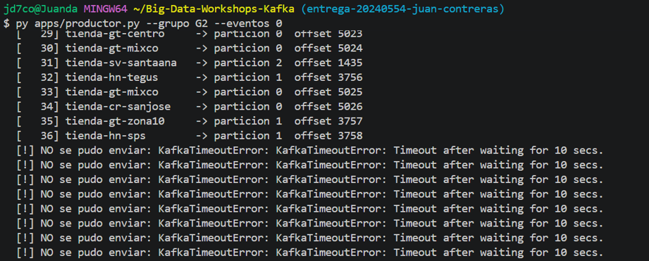
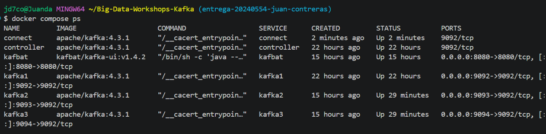
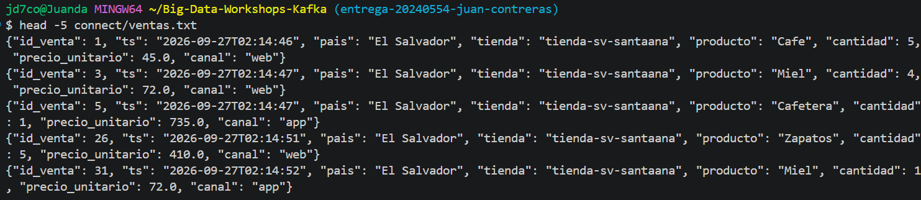

# Bitácora del taller de Kafka

* **Nombre:** Juan Contreras
* **Carné:** 20240554
* **Grupo:** G2
* **Enlace a tu video:** `video-demo.mp4` (en esta misma carpeta)

## 1. Evidencias

### E1. Los tres brokers y el detalle de tu topic (Pasos 6 y 7)





Lo que muestra:

La evidencia confirma que el clúster tiene los tres brokers activos, con IDs `11`, `12` y `13`. También muestra que el topic `ventas-G2` tiene 3 particiones, factor de replicación 3 y tres réplicas en el ISR de cada partición.

### E2. La interfaz web con tu topic de ventas (Paso 8)




Lo que muestra:

La interfaz web de Kafbat muestra el topic `ventas-G2` y permite consultar sus particiones y mensajes. En la vista se puede comprobar que el topic está replicado entre los tres brokers y que contiene los eventos producidos durante la práctica.

### E3. Varios consumidores repartiéndose las particiones (Paso 8)



Lo que muestra:

La evidencia muestra el grupo `20240554-principal` con consumidores asignados a las particiones de `ventas-G2`. También se observa el `LAG` de cada partición, incluyendo valores como `0` y `1`, lo que permite comprobar el estado de lectura del grupo.

### E4. Falla de un broker (Paso 9)





Lo que muestra:

Al detener `kafka2`, las particiones de `ventas-G2` pasaron de tener tres réplicas en el ISR a tener solamente dos, pero el productor continuó enviando eventos sin errores. Esto demuestra que `min.insync.replicas=2` permitía continuar escribiendo mientras todavía quedaban dos réplicas sincronizadas.

### E5. Escrituras rechazadas (Paso 10)





Lo que muestra:

En el topic `sin-copias`, al detener los brokers que contenían algunas particiones, se observó `Leader: none` para las particiones afectadas. Posteriormente, el productor recibió `KafkaTimeoutError`, mostrando que no podía completar las escrituras en las condiciones configuradas.

### E6. Kafka Connect escribiendo el archivo (Paso 11)





Lo que muestra:

Kafka Connect aparece ejecutándose y el `FileStreamSinkConnector` recibe los eventos del topic `ventas-G2` y los escribe en `connect/ventas.txt`. El archivo contiene directamente los eventos JSON producidos por Kafka, sin tener que desarrollar un consumidor Python adicional para este sink.

## 2. Preguntas

**1. ¿Qué guarda el controller y qué guarda cada broker? Justifícalo con lo que viste, y compáralo con el NameNode y los DataNodes del taller anterior.**

El controller guarda principalmente el estado y metadatos del clúster, como la información necesaria para administrar topics, particiones y configuración. Lo comprobé al revisar su almacenamiento, donde aparecía principalmente `__cluster_metadata-0`, mientras que en los brokers estaban los directorios correspondientes a las particiones de los topics. La comparación con Hadoop es que el controller se parece conceptualmente al NameNode porque mantiene información de administración y metadatos, mientras que los brokers se parecen a los DataNodes porque almacenan físicamente los datos, aunque Kafka y HDFS tienen arquitecturas y responsabilidades diferentes.

**2. Con tu `--describe`: ¿cuántas particiones tiene tu topic, quién es líder de cada una y qué significa que el Isr tenga tres entradas?**

Mi topic `ventas-G2` tiene 3 particiones y utiliza un factor de replicación de 3. En una de las comprobaciones, la partición 0 tenía como líder al broker `13`, la partición 1 al broker `11` y la partición 2 al broker `12`; las tres tenían los brokers `11`, `12` y `13` dentro del ISR. Tener tres entradas en `Isr` significa que las tres réplicas están sincronizadas y pueden participar en la recuperación o en la confirmación de escrituras según la configuración del topic.

**3. Produjiste con la tienda como clave. ¿Por qué una misma tienda cae siempre en la misma partición y qué garantía de orden te da eso? ¿Qué perderías si produjeras sin clave?**

Kafka utiliza la clave del mensaje para determinar la partición mediante su mecanismo de particionamiento, por lo que una misma tienda mantiene la misma asignación de partición mientras no cambie la configuración relevante del topic. Esto permite conservar el orden de los mensajes de esa tienda dentro de esa partición, aunque Kafka no garantiza un orden global entre las tres particiones. Si produjera sin clave, los eventos podrían distribuirse entre diferentes particiones y perdería esa garantía de orden por tienda, dificultando reconstruir la secuencia de eventos de una tienda específica.

**4. Corriste dos, tres y cuatro consumidores en el mismo grupo de lectura. ¿Qué pasó con el cuarto y por qué? ¿Qué cambió con un `--grupo-lectura` distinto?**

Al utilizar varios consumidores con el mismo grupo, Kafka repartió las particiones disponibles entre ellos. Como `ventas-G2` tiene solamente 3 particiones, al ejecutar un cuarto consumidor no había una cuarta partición que asignarle, por lo que ese consumidor quedó sin trabajo mientras los otros consumidores procesaban las tres particiones. Cuando utilicé un `--grupo-lectura` diferente, Kafka trató a ese grupo como un lector independiente y volvió a permitirle consumir los mensajes, en lugar de repartir las mismas particiones con el grupo anterior.

**5. Al detener brokers, en un caso el productor siguió y en otro falló. Explica por qué, y relaciona `acks` y `min.insync.replicas` con la C y la A del teorema CAP.**

En `ventas-G2`, con `min.insync.replicas=2` y tres réplicas, al detener `kafka2` todavía quedaron dos réplicas sincronizadas, por lo que el productor pudo continuar escribiendo con `acks="all"`. En cambio, en `sin-copias` algunas particiones quedaron sin líder al detener los brokers que las alojaban, y el productor terminó con `KafkaTimeoutError`. Esto muestra el equilibrio entre consistencia y disponibilidad: `acks="all"` exige confirmación de las réplicas disponibles y `min.insync.replicas=2` evita aceptar determinadas escrituras cuando no existe suficiente replicación; en términos de CAP, ante una partición o pérdida de nodos se pueden mantener garantías de consistencia aunque algunas escrituras dejen de estar disponibles.

**6. Sacaste los datos a un archivo con tu consumidor y con Kafka Connect. ¿Qué tuviste que resolver para que Connect funcionara, y en qué caso real preferirías cada forma?**

Con el consumidor Python tuve que utilizar código propio para leer los eventos y guardarlos como JSONL en `salida/ventas-G2.jsonl`. Para Kafka Connect tuve que configurar el worker, indicar `kafka1:19092` como broker interno, utilizar `StringConverter` sin schemas porque los eventos eran JSON plano, establecer el `plugin.path` y configurar `FileStreamSinkConnector` para escribir en `connect/ventas.txt`. En un caso real preferiría un consumidor propio cuando necesito transformar, validar o procesar cada evento con lógica específica; utilizaría Kafka Connect cuando necesito mover datos de forma estándar hacia un sistema soportado por un connector y quiero evitar mantener código de consumo personalizado.

## 3. Mini-reto de tu grupo

**Pregunta asignada a tu grupo:**

¿Cuáles son los 5 productos con más unidades vendidas? ¿Cuántas vendió el primero?

**Tu programa** (también va como `mini-reto.py`):

```python
import json

unidades = {}

with open("salida/ventas-G2.jsonl", "r", encoding="utf-8") as archivo:
    for linea in archivo:
        evento = json.loads(linea)
        producto = evento["producto"]
        cantidad = evento["cantidad"]

        unidades[producto] = unidades.get(producto, 0) + cantidad

top_5 = sorted(unidades.items(), key=lambda x: x[1], reverse=True)[:5]

print("Top 5 productos por unidades vendidas:")

for posicion, (producto, total) in enumerate(top_5, start=1):
    print(f"{posicion}. {producto}: {total} unidades")
```

**Resultado de tu programa** — la salida tal como la imprimió, y también la línea del `wc -l`:

```text
2000 salida/ventas-G2.jsonl
```

```text
Top 5 productos por unidades vendidas:
1. Zapatos: 665 unidades
2. Cafe: 636 unidades
3. Licuadora: 633 unidades
4. Balon: 629 unidades
5. Bicicleta: 608 unidades
```

Interpretacion: En los 2000 eventos procesados, Zapatos fue el producto con mayor cantidad de unidades vendidas, con 665 unidades, seguido por Cafe con 636.

## 4. Problemas encontrados (opcional)

(Sin problemas)
