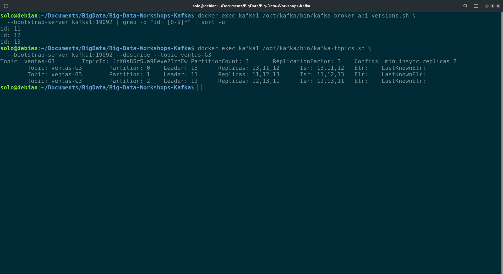
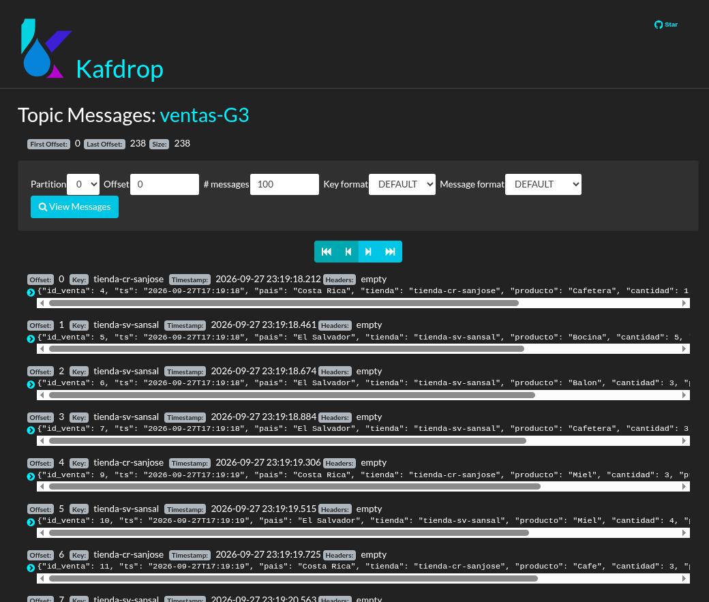
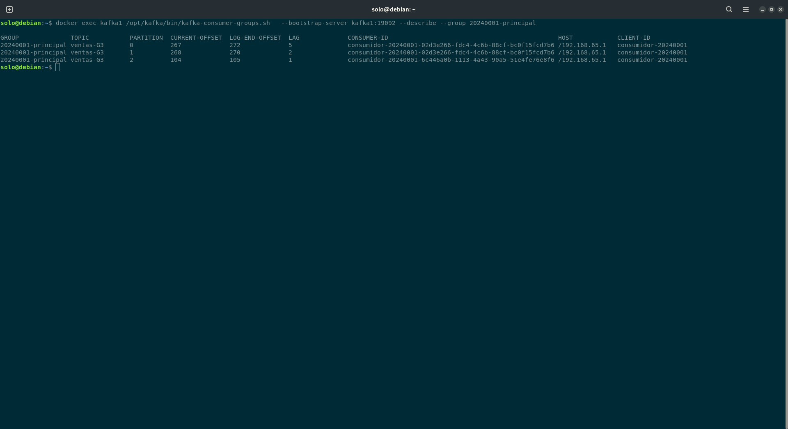
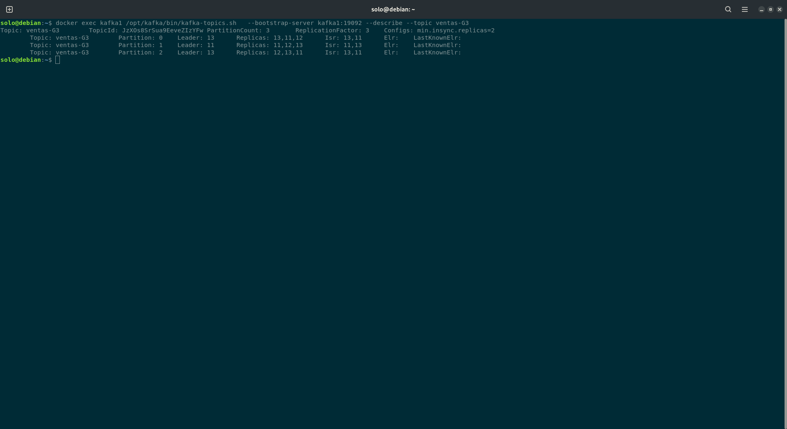
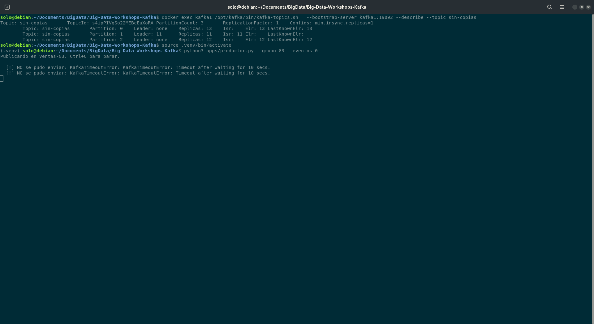
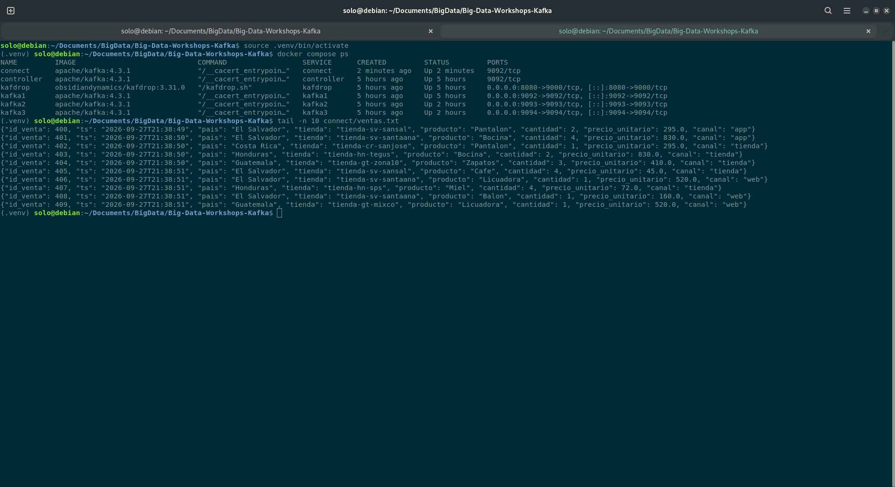

# Bitácora del taller de Kafka

- **Nombre:** Juan Ochaita
- **Carné:** 20240563
- **Grupo:** G3
- **Enlace a tu video:** `video-demo.mp4` (en esta misma carpeta)

## 1. Evidencias

### E1. Los tres brokers y el detalle de tu topic (Pasos 6 y 7)



Lo que muestra: Muestra los brokers 11, 12 y 13. El topic ventas-G3 tiene tres particiones, tres réplicas por partición y min.insync.replicas=2.

### E2. La interfaz web con tu topic de ventas (Paso 8)



Lo que muestra: Muestra los brokers 11, 12 y 13. El topic ventas-G3 tiene tres particiones, tres réplicas por partición y min.insync.replicas=2.

### E3. Varios consumidores repartiéndose las particiones (Paso 8)



Lo que muestra: Muestra el grupo 20240001-principal, sus particiones y los valores de LAG. Se ven dos CONSUMER-ID distintos.

### E4. Falla de un broker (Paso 9)



Lo que muestra: Muestra que, con kafka2 detenido, cada partición conserva dos réplicas sincronizadas en el ISR.

### E5. Escrituras rechazadas (Paso 10)



Lo que muestra: Muestra particiones del topic sin-copias sin líder y los errores de timeout del productor al publicar en ventas-G3.

### E6. Kafka Connect escribiendo el archivo (Paso 11)



Lo que muestra: Muestra el contenedor connect activo y eventos JSON escritos en connect/ventas.txt.

## 2. Preguntas

**1. ¿Qué guarda el controller y qué guarda cada broker? Justifícalo con lo que viste, y compáralo con el NameNode y los DataNodes del taller anterior.**

El controller guarda los metadatos del clúster, como la información de los topics y la asignación de particiones. Los brokers guardan los mensajes; en ventas-G3, esos datos están repartidos entre tres particiones. Es parecido al NameNode, que administra el sistema, y los DataNodes, que almacenan los bloques.

**2. Con tu `--describe`: ¿cuántas particiones tiene tu topic, quién es líder de cada una y qué significa que el Isr tenga tres entradas?**

ventas-G3 tiene tres particiones. En mi salida, la partición 0 tiene líder 13, la 1 líder 11 y la 2 líder 12. Cada ISR contiene tres brokers, lo que indica que las tres réplicas están sincronizadas.

**3. Produjiste con la tienda como clave. ¿Por qué una misma tienda cae siempre en la misma partición y qué garantía de orden te da eso? ¿Qué perderías si produjeras sin clave?**

El productor usa el nombre de la tienda como clave; los eventos de una tienda, como tienda-sv-sansal, se envían a la misma partición. Así Kafka conserva su orden dentro de esa partición. Sin clave, los eventos podrían distribuirse entre particiones y perderían ese orden común.

**4. Corriste dos, tres y cuatro consumidores en el mismo grupo de lectura. ¿Qué pasó con el cuarto y por qué? ¿Qué cambió con un `--grupo-lectura` distinto?**

Con tres particiones, como máximo tres consumidores del mismo grupo reciben particiones; el cuarto queda sin asignación. En mi captura de 20240001-principal aparecen dos CONSUMER-ID distintos. Un --grupo-lectura diferente crea otro grupo con sus propios offsets y lectura independiente.

**5. Al detener brokers, en un caso el productor siguió y en otro falló. Explica por qué, y relaciona `acks` y `min.insync.replicas` con la C y la A del teorema CAP.**

Al detener kafka2, ventas-G3 conservó dos réplicas en el ISR por partición y el productor siguió, cumpliendo min.insync.replicas=2. En el caso sin-copias, las particiones 0 y 2 quedaron sin líder y el productor registró timeouts. Con acks=all, Kafka rechazó escrituras sin suficientes réplicas: priorizó consistencia sobre disponibilidad.

**6. Sacaste los datos a un archivo con tu consumidor y con Kafka Connect. ¿Qué tuviste que resolver para que Connect funcionara, y en qué caso real preferirías cada forma?**

Configuré Kafka Connect para conectarse a kafka1:19092, leer ventas-G3 y escribir eventos JSON en connect/ventas.txt; también habilité el JAR de FileStreamSink. Elegiría Connect para mover datos entre sistemas con configuración; usaría mi consumidor cuando necesite transformar o filtrar los eventos.

## 3. Mini-reto de tu grupo

**Pregunta asignada a tu grupo:** ¿Qué tienda vendió más en dinero, y cuánto? Total por tienda.

**Tu programa** (también va como `mini-reto.py`):

```python
import json
from collections import defaultdict

totales = defaultdict(float)

with open("salida/ventas-G3.jsonl", encoding="utf-8") as archivo:
    for linea in archivo:
        evento = json.loads(linea)
        totales[evento["tienda"]] += evento["cantidad"] * evento["precio_unitario"]

tienda, total = max(totales.items(), key=lambda elemento: elemento[1])
print(f"{tienda}: Q{total:.2f}")
```

**Resultado de tu programa** — la salida tal como la imprimió, y también la línea del `wc -l`:

```
tienda-cr-sanjose: Q833331.00
```

**Interpretación en una frase:** La tienda con mayores ventas fue tienda-cr-sanjose, con un total de Q833,331.00 en los 2000 eventos analizados.
