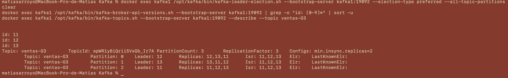
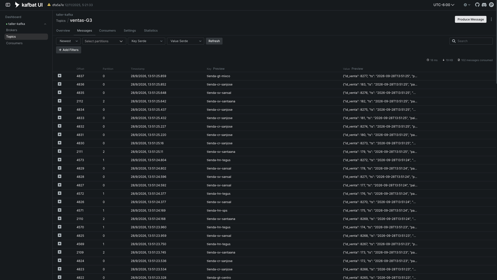
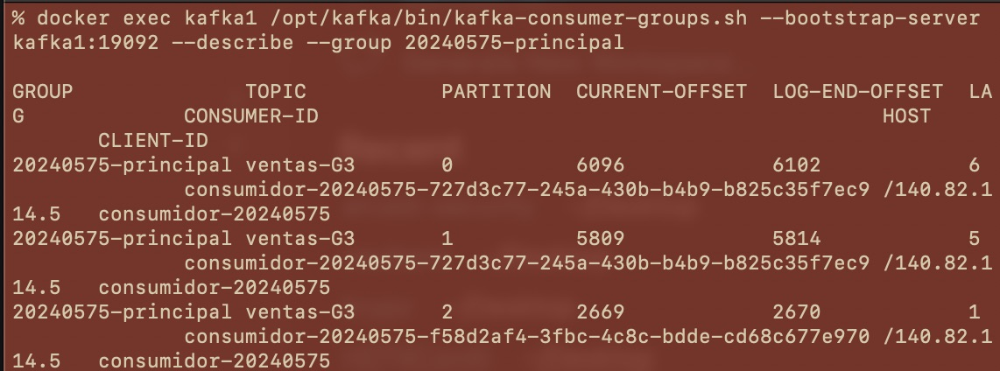
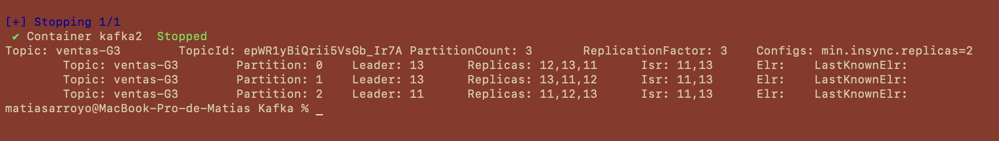
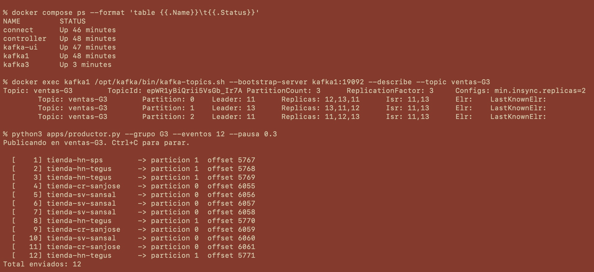
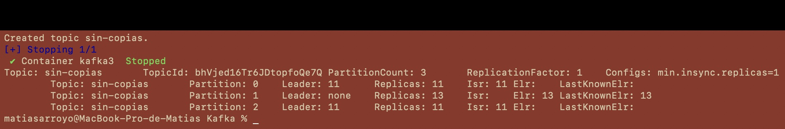
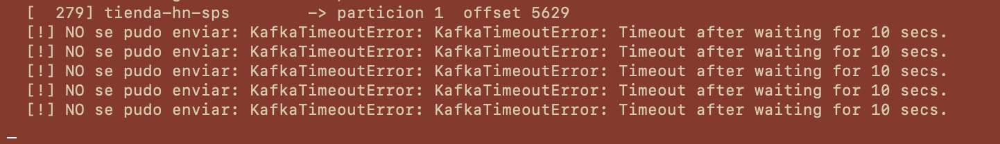
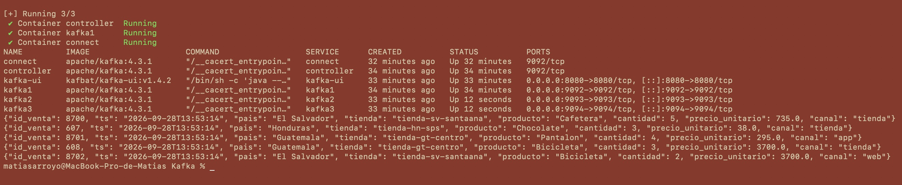

# Bitácora del taller de Kafka

- **Nombre:** Matías Arroyo
- **Carné:** 20240575
- **Grupo:** G3
- **Enlace a tu video:** `video-demo.mp4` (en esta misma carpeta)

## 1. Evidencias

### E1. Los tres brokers y el detalle de tu topic (Pasos 6 y 7)



Lo que muestra: `kafka-broker-api-versions.sh` devuelve los tres brokers del clúster (ids 11, 12 y 13) y
el `--describe` de `ventas-G3` muestra 3 particiones con `ReplicationFactor: 3`,
`min.insync.replicas=2` y el `Isr` completo (tres brokers) en cada partición.

### E2. La interfaz web con tu topic de ventas (Paso 8)



Lo que muestra: kafbat Kafka UI en `http://localhost:8080`, conectada por la red interna de Docker
(`kafka1:19092`), con el topic `ventas-G3` abierto y los mensajes JSON de las ventas.

### E3. Varios consumidores repartiéndose las particiones (Paso 8)



Lo que muestra: `kafka-consumer-groups.sh --describe` del grupo `20240575-principal`, con varios
`CONSUMER-ID` distintos, cada uno con sus particiones de `ventas-G3`, y la columna `LAG` de cada una.

### E4. Falla de un broker (Paso 9)





Lo que muestra: con `kafka2` detenido, el `--describe` de `ventas-G3` tiene el `Isr` en dos brokers
(11 y 13) y la partición 0, que lideraba el 12, pasó a otro líder; el productor sigue enviando sin errores.

### E5. Escrituras rechazadas (Paso 10)





Lo que muestra: con `kafka2` y `kafka3` detenidos, el topic `sin-copias` tiene las particiones 1 y 2
en `Leader: none`, y el productor de `ventas-G3` falla con `KafkaTimeoutError` porque solo queda una
copia al día.

### E6. Kafka Connect escribiendo el archivo (Paso 11)



Lo que muestra: el contenedor `connect` corriendo en `docker compose ps` y el `tail` de
`connect/ventas.txt` con los eventos de `ventas-G3`, un JSON por línea, escritos sin código propio.

## 2. Preguntas

**1. ¿Qué guarda el controller y qué guarda cada broker? Justifícalo con lo que viste, y compáralo con el NameNode y los DataNodes del taller anterior.**

El controller solo guarda la metadata del clúster: en su disco únicamente vi `__cluster_metadata-0`,
`bootstrap.checkpoint` y `meta.properties`, sin ninguna carpeta de topic. En cambio `kafka1` tiene
además una carpeta por partición (`tiendas-G3-0..2`, `ventas-G3-0..2`), que es donde viven los
mensajes. Es la misma división que en Hadoop: el controller es como el NameNode (sabe qué existe y
dónde) y los brokers 11, 12 y 13 son como los DataNodes (guardan los datos y sus copias).

**2. Con tu `--describe`: ¿cuántas particiones tiene tu topic, quién es líder de cada una y qué significa que el Isr tenga tres entradas?**

Mi topic `ventas-G3` tiene 3 particiones con 3 réplicas cada una. En mi `--describe` la partición 0
tiene como líder al broker 12, la partición 1 al 13 y la partición 2 al 11, así que Kafka repartió
un liderazgo a cada broker. Que el `Isr` tenga tres entradas (por ejemplo `12,13,11` en la partición 0)
significa que las tres copias están al día con el líder, así que si uno cae no se pierde nada.

**3. Produjiste con la tienda como clave. ¿Por qué una misma tienda cae siempre en la misma partición y qué garantía de orden te da eso? ¿Qué perderías si produjeras sin clave?**

El productor calcula un hash de la clave y lo divide entre el número de particiones, así que la misma
tienda siempre da la misma partición. En mi clúster `tienda-cr-sanjose` siempre cayó en la partición 0,
`tienda-hn-tegus` en la 1 y `tienda-sv-santaana` en la 2. Como Kafka garantiza orden solo dentro de
una partición, las ventas de cada tienda se leen en el orden en que ocurrieron. Sin clave los mensajes
se reparten entre particiones y las ventas de una misma tienda podrían leerse desordenadas.

**4. Corriste dos, tres y cuatro consumidores en el mismo grupo de lectura. ¿Qué pasó con el cuarto y por qué? ¿Qué cambió con un `--grupo-lectura` distinto?**

Con cuatro consumidores en `20240575-principal`, el `--describe` del grupo solo mostró tres
`CONSUMER-ID`, uno por partición, y el cuarto se quedó sin asignación y sin recibir nada. Pasa porque
dentro de un grupo cada partición la lee un solo consumidor, y mi topic solo tiene 3 particiones. Con
`--grupo-lectura auditoria` el consumidor leyó todo desde el offset 0, porque cada grupo guarda sus
propios offsets y no compite con el grupo `principal`.

**5. Al detener brokers, en un caso el productor siguió y en otro falló. Explica por qué, y relaciona `acks` y `min.insync.replicas` con la C y la A del teorema CAP.**

Al detener `kafka2` el `Isr` bajó a `13,11` y quedaban 2 copias al día, que es justo el mínimo de
`min.insync.replicas=2`, así que el productor siguió. Al detener también `kafka3` el `Isr` quedó en
solo `11` y el log de `kafka1` mostró `NotEnoughReplicasException: The size of the current ISR : 1 is
insufficient to satisfy the min.isr requirement of 2`, por lo que el productor falló con timeout. Con
`acks="all"` y `min.insync.replicas=2` Kafka prefiere la consistencia (C) y rechaza antes que guardar
datos sin respaldo; con `acks=1` o `min.insync.replicas=1` habría aceptado, eligiendo disponibilidad (A).

**6. Sacaste los datos a un archivo con tu consumidor y con Kafka Connect. ¿Qué tuviste que resolver para que Connect funcionara, y en qué caso real preferirías cada forma?**

Para Connect tuve que usar la dirección interna `kafka1:19092,kafka2:19092,kafka3:19092`, cambiar el
converter a `StringConverter` porque el `JsonConverter` por defecto esperaba `schema` y `payload`, y
poner `plugin.path=/opt/kafka/libs/connect-file-4.3.1.jar` porque en Kafka 4 el conector no se carga
solo. Preferiría Connect para copiar un topic tal cual a otro sistema (archivo, base de datos, S3) sin
mantener código, y mi propio consumidor cuando haya que filtrar, transformar o aplicar reglas de negocio.

## 3. Mini-reto de tu grupo

**Pregunta asignada a tu grupo:** ¿Qué tienda vendió más en dinero, y cuánto? Total por tienda.

**Tu programa** (también va como `mini-reto.py`):

```python
"""Mini-reto G3: que tienda vendio mas en dinero, y cuanto. Total por tienda.

Lee salida/ventas-G3.jsonl (un evento JSON por linea, 2000 en total) y suma
cantidad x precio_unitario por tienda.
"""
import json
from collections import defaultdict

total_por_tienda = defaultdict(float)
ventas_por_tienda = defaultdict(int)
eventos = 0

with open("salida/ventas-G3.jsonl", encoding="utf-8") as f:
    for linea in f:
        evento = json.loads(linea)
        monto = evento["cantidad"] * evento["precio_unitario"]
        total_por_tienda[evento["tienda"]] += monto
        ventas_por_tienda[evento["tienda"]] += 1
        eventos += 1

print(f"Eventos leidos: {eventos}\n")
print(f"{'Tienda':22s} {'Ventas':>7s} {'Total':>14s}")
ranking = sorted(total_por_tienda.items(), key=lambda t: t[1], reverse=True)
for tienda, total in ranking:
    print(f"{tienda:22s} {ventas_por_tienda[tienda]:7d} {total:14,.2f}")

ganadora, monto = ranking[0]
print(f"\nLa tienda que mas vendio en dinero es {ganadora}, con {monto:,.2f}.")
```

**Resultado de tu programa** — la salida tal como la imprimió, y también la línea del `wc -l`:

```
$ wc -l salida/ventas-G3.jsonl
    2000 salida/ventas-G3.jsonl

$ python3 entregas/G3/20240575-matias-arroyo/mini-reto.py
Eventos leidos: 2000

Tienda                  Ventas          Total
tienda-cr-sanjose          364     833,331.00
tienda-hn-tegus            378     741,738.00
tienda-sv-santaana         354     728,480.00
tienda-sv-sansal           348     702,344.00
tienda-hn-sps              370     669,765.00
tienda-gt-centro            66     230,061.00
tienda-gt-mixco             62     149,394.00
tienda-gt-zona10            58      99,275.00

La tienda que mas vendio en dinero es tienda-cr-sanjose, con 833,331.00.
```

**Interpretación en una frase:** `tienda-cr-sanjose` es la que más vende en dinero (833,331.00) aunque
`tienda-hn-tegus` tiene más ventas (378 contra 364), porque es la única tienda de Costa Rica y se
lleva todo el volumen de ese país, mientras que las tres tiendas de Guatemala juntas apenas superan
los 478,000.

## 4. Problemas encontrados

- `pip3 install` falló en macOS por PEP 668 (Python gestionado por Homebrew); lo resolví creando un
  entorno virtual (`python3 -m venv venv`) e instalando ahí `kafka-python`.
- Después de reiniciar `kafka2` y `kafka3` todas las particiones quedaron con líder 11; lo devolví al
  reparto original con `kafka-leader-election.sh --election-type preferred --all-topic-partitions`.
