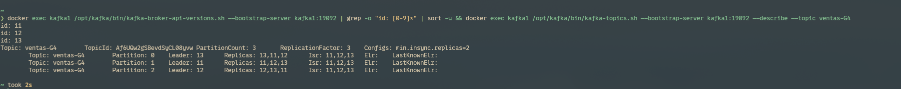
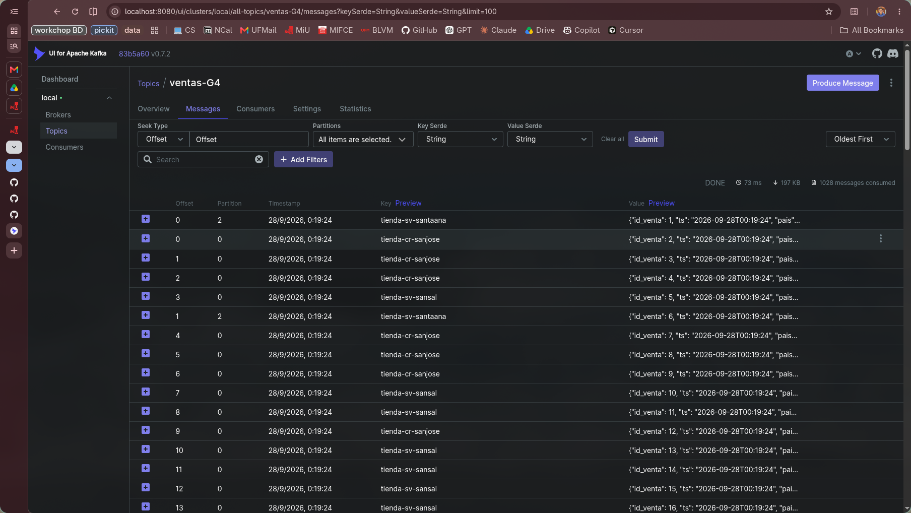
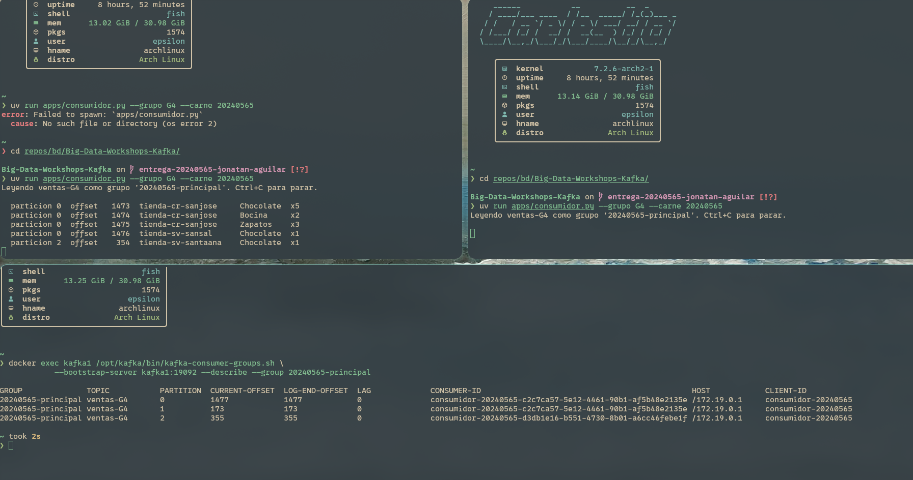
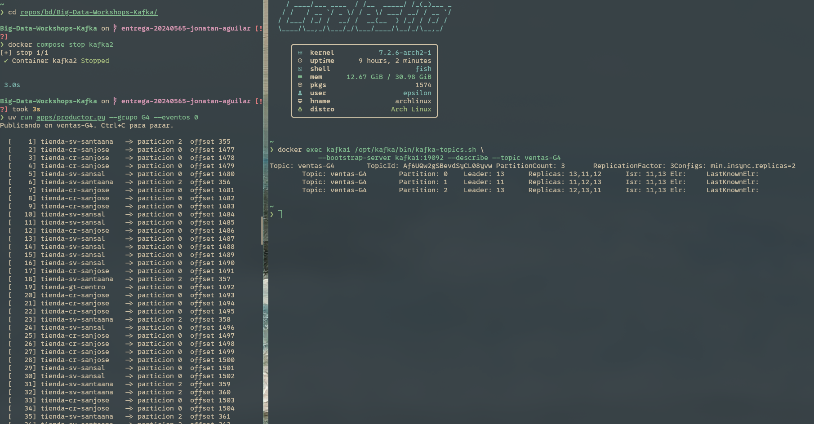
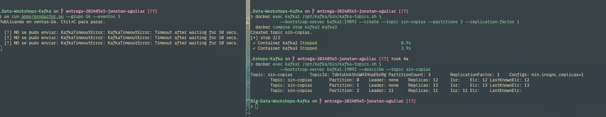
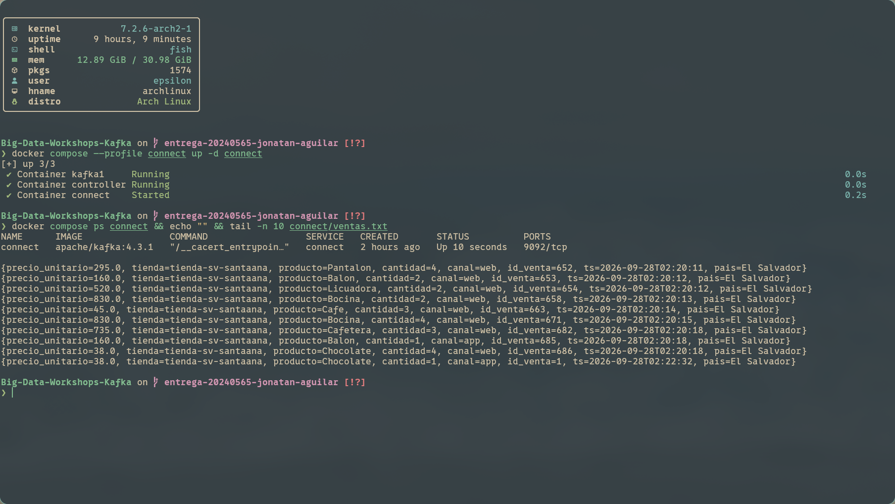

# Bitácora del taller de Kafka

- **Nombre:** Jonatan Aguilar
- **Carné:** 20240565
- **Grupo:** G4
- **Enlace a tu video:** `video-demo.mp4` (en esta misma carpeta)

## 1. Evidencias

### E1. Los tres brokers y el detalle de tu topic (Pasos 6 y 7)



Lo que muestra: La salida de kafka-broker-api-versions listando los brokers 11, 12 y 13 activos en el clúster, junto con el describe de ventas-G4 mostrando 3 particiones con ReplicationFactor 3, min.insync.replicas=2 y los tres nodos en el Isr.

### E2. La interfaz web con tu topic de ventas (Paso 8)



Lo que muestra: La consola web de kafka-ui en el puerto 8080 visualizando el topic ventas-G4, su distribución de réplicas en los brokers y el flujo de mensajes recibidos en tiempo real.

### E3. Varios consumidores repartiéndose las particiones (Paso 8)



Lo que muestra: La descripción del grupo de consumo 20240565-principal donde se observan dos consumidores activos repartiéndose las 3 particiones de ventas-G4 junto con sus offsets y la columna LAG.

### E4. Falla de un broker (Paso 9)



Lo que muestra: El estado de ventas-G4 tras detener kafka2, donde el Isr se reduce a dos réplicas (11 y 13) y se reeligen líderes, mientras el productor continúa publicando mensajes exitosamente sin interrupciones.

### E5. Escrituras rechazadas (Paso 10)



Lo que muestra: El topic sin-copias con Leader: none en dos particiones tras detener kafka2 y kafka3, y el productor fallando con KafkaTimeoutError al no cumplirse la regla de min.insync.replicas=2 para ventas-G4.

### E6. Kafka Connect escribiendo el archivo (Paso 11)



Lo que muestra: El servicio de Kafka Connect en ejecución volcando continuamente los eventos de ventas-G4 hacia el archivo local connect/ventas.txt mediante el conector FileStreamSink sin requerir código personalizado.

## 2. Preguntas

**1. ¿Qué guarda el controller y qué guarda cada broker? Justifícalo con lo que viste, y compáralo con el NameNode y los DataNodes del taller anterior.**
En disco comprobamos con `docker exec controller ls /var/lib/kafka/data` que el controller únicamente almacena metadatos del clúster (`__cluster_metadata-0`, `meta.properties` y `bootstrap.checkpoint`), sin guardar ninguna partición ni mensaje. En cambio, en `kafka1` encontramos carpetas físicas por partición como `ventas-G4-0`, `ventas-G4-1`, `ventas-G4-2` y `tiendas-G4-0`, donde residen los archivos `.log` e índices con los datos crudos. Esto equivale directamente a la arquitectura HDFS anterior: el controller actúa como el NameNode centralizando el catálogo y estado, mientras que cada broker opera como un DataNode persistiendo los bloques físicos de información.

**2. Con tu `--describe`: ¿cuántas particiones tiene tu topic, quién es líder de cada una y qué significa que el Isr tenga tres entradas?**
Al ejecutar `--describe --topic ventas-G4`, el clúster reportó 3 particiones (`0`, `1` y `2`) con `ReplicationFactor: 3`. Cada partición cuenta con su propio líder asignado (`Leader: 11`, `12` o `13` según el momento del rebalanceo), encargado de coordinar lecturas y escrituras. Que el `Isr` (In-Sync Replicas) contenga las tres entradas `[11, 12, 13]` significa que las tres réplicas físicas están totalmente sincronizadas con el líder, habiendo confirmado todas las operaciones hasta el *high watermark* sin retrasos de replicación.

**3. Produjiste con la tienda como clave. ¿Por qué una misma tienda cae siempre en la misma partición y qué garantía de orden te da eso? ¿Qué perderías si produjeras sin clave?**
Kafka aplica una función hash determinista (MurmurHash2) sobre los bytes de la clave para calcular `hash(key) % num_partitions`. Por ello, eventos de `tienda-cr-sanjose` cayeron invariablemente en la partición `0`, `tienda-hn-sps` en la `1` y `tienda-sv-santaana` en la `2`. La garantía obtenida es orden secuencial estricto de eventos por tienda, ya que Kafka preserva el orden únicamente a nivel de partición mediante sus offsets consecutivos. Si produjéramos sin clave (`key=None`), los mensajes se dispersarían en *round-robin* entre las tres particiones, perdiendo por completo la secuencia cronológica de transacciones por sucursal.

**4. Corriste dos, tres y cuatro consumidores en el mismo grupo de lectura. ¿Qué pasó con el cuarto y por qué? ¿Qué cambió con un `--grupo-lectura` distinto?**
Dado que el protocolo de Kafka asigna cada partición a un único consumidor dentro de un mismo grupo, con dos consumidores uno tomó dos particiones (0 y 1) y el otro una (2); con tres consumidores hubo reparto 1 a 1. Al agregar un cuarto consumidor al grupo `20240565-principal`, este quedó completamente inactivo (*idle*) sin particiones asignadas porque no pueden coexistir más consumidores activos que particiones disponibles (4 > 3). Al especificar otro grupo como `20240565-reto`, Kafka lo manejó de forma independiente con sus propios offsets en `__consumer_offsets`, permitiéndole procesar todo el historial desde el inicio sin competir con el grupo anterior.

**5. Al detener brokers, en un caso el productor siguió y en otro falló. Explica por qué, y relaciona `acks` y `min.insync.replicas` con la C y la A del teorema CAP.**
El productor corre configurado con `acks="all"` y el topic exige `min.insync.replicas=2`. Al apagar `kafka2`, el `Isr` bajó de 3 a 2 réplicas vivas (`11` y `13`); como 2 satisface el mínimo requerido, Kafka aceptó escrituras sin fallos. Al apagar también `kafka3`, el `Isr` se redujo a 1 solo nodo vivo (`11`); al violarse el umbral de 2, el broker rechazó las escrituras arrojando `NotEnoughReplicasException` en los logs del servidor y `KafkaTimeoutError` en el productor. En términos del teorema CAP, esta configuración prioriza Consistencia (**C**) sobre Disponibilidad (**A**): ante una partición o fallo, el clúster prefiere rechazar escrituras antes que almacenar datos con riesgo de pérdida.

**6. Sacaste los datos a un archivo con tu consumidor y con Kafka Connect. ¿Qué tuviste que resolver para que Connect funcionara, y en qué caso real preferirías cada forma?**
Para hacer funcionar Kafka Connect tuvimos que apuntar `bootstrap.servers` a la red interna de Docker (`kafka1:19092,kafka2:19092,kafka3:19092`), deshabilitar esquemas en los convertidores JSON (`schemas.enable=false`) para aceptar el JSON plano del productor, e incluir en `plugin.path` la ruta al JAR del conector `/opt/kafka/libs/connect-file-4.3.1.jar` que KRaft no cargaba por omisión. En la práctica real, Kafka Connect es preferible para tuberías estándar de ingesta (hacia data lakes, S3, HDFS o bases de datos) al ofrecer tolerancia a fallos y gestión de offsets sin código. Un consumidor propio en Python es preferible cuando se requiere lógica de negocio compleja, filtrado, enriquecimiento en memoria o llamados a APIs externas durante el consumo.

## 3. Mini-reto de tu grupo

**Pregunta asignada a tu grupo:**
Tratando cada evento como una venta, ¿cuál es el monto promedio (cantidad × precio_unitario) por canal, qué canal tiene el más alto y cuántas ventas tuvo cada canal?

**Tu programa** (también va como `mini-reto.py`):

```python
#!/usr/bin/env python3
"""Mini-reto Grupo G4: Analisis de ventas por canal.

Pregunta asignada:
Tratando cada evento como una venta, ¿cual es el monto promedio
(cantidad x precio_unitario) por canal, que canal tiene el mas alto
y cuantas ventas tuvo cada canal?
"""
import json
from collections import defaultdict
from pathlib import Path


def main():
    archivo = Path("salida/ventas-G4.jsonl")
    if not archivo.exists():
        archivo = Path("../../salida/ventas-G4.jsonl")

    ventas_por_canal = defaultdict(int)
    monto_por_canal = defaultdict(float)

    total_eventos = 0
    with open(archivo, "r", encoding="utf-8") as f:
        for linea in f:
            linea = linea.strip()
            if not linea:
                continue
            evento = json.loads(linea)
            canal = evento["canal"]
            monto = evento["cantidad"] * evento["precio_unitario"]

            ventas_por_canal[canal] += 1
            monto_por_canal[canal] += monto
            total_eventos += 1

    print(f"Total de ventas procesadas: {total_eventos}")
    print("\nResultados por canal:")
    print(f"{'Canal':<10} | {'Ventas':<8} | {'Monto Total ($)':<16} | {'Monto Promedio ($)':<18}")
    print("-" * 60)

    canal_mayor_promedio = None
    max_promedio = -1.0

    for canal in sorted(ventas_por_canal.keys()):
        ventas = ventas_por_canal[canal]
        total = monto_por_canal[canal]
        promedio = total / ventas
        print(f"{canal:<10} | {ventas:<8d} | {total:<16.2f} | {promedio:<18.2f}")

        if promedio > max_promedio:
            max_promedio = promedio
            canal_mayor_promedio = canal

    print("-" * 60)
    print(f"Canal con el monto promedio mas alto: {canal_mayor_promedio} (${max_promedio:.2f})")


if __name__ == "__main__":
    main()
```

**Resultado de tu programa** — la salida tal como la imprimió, y también la línea del `wc -l`:

```
2000 salida/ventas-G4.jsonl

Total de ventas procesadas: 2000

Resultados por canal:
Canal      | Ventas   | Monto Total ($)  | Monto Promedio ($)
------------------------------------------------------------
app        | 282      | 529597.00        | 1878.00           
tienda     | 302      | 750529.00        | 2485.20           
web        | 1416     | 2795270.00       | 1974.06           
------------------------------------------------------------
Canal con el monto promedio mas alto: tienda ($2485.20)
```

**Interpretación en una frase:** Aunque el canal web concentra la gran mayoría del volumen con 1416 de las 2000 transacciones, las ventas presenciales en tienda física presentan el monto promedio más elevado con $2485.20 por compra frente a los $1878.00 del canal móvil app y los $1974.06 de la web.

## 4. Problemas encontrados (opcional)

Durante la integración de Kafka Connect en KRaft, la imagen oficial de Kafka no cargaba los plugins de FileStreamSink de forma automática ni soportaba la validación de esquemas estricta para JSON plano; esto se solventó definiendo explícitamente el plugin.path hacia el JAR connect-file-4.3.1.jar y deshabilitando schemas.enable en el convertidor.
