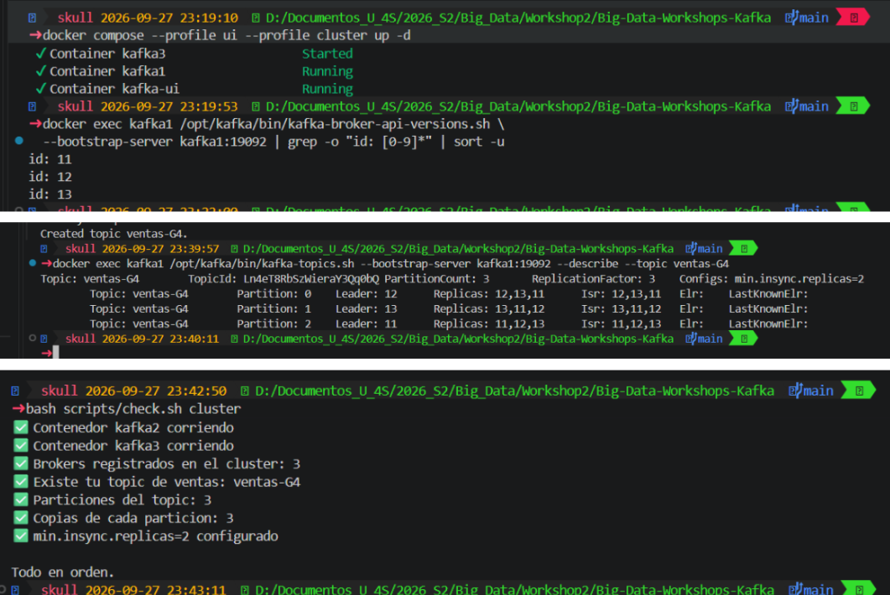
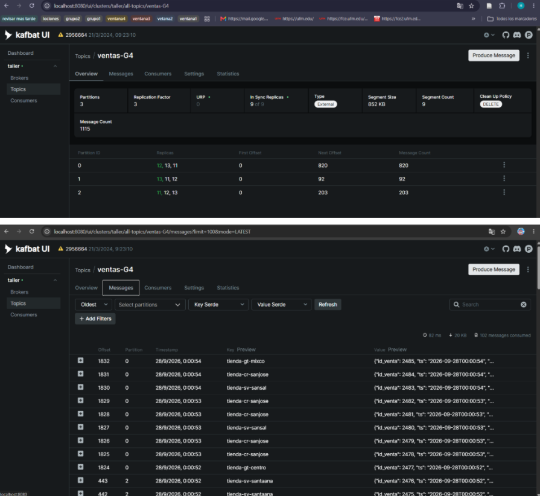
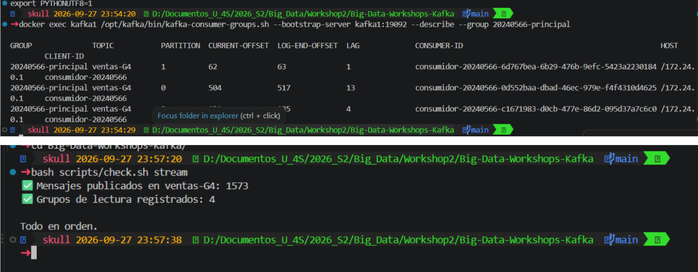
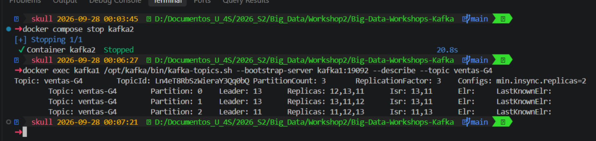
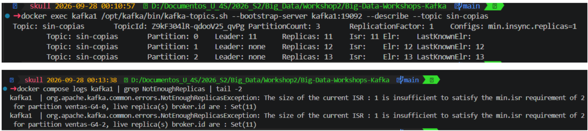
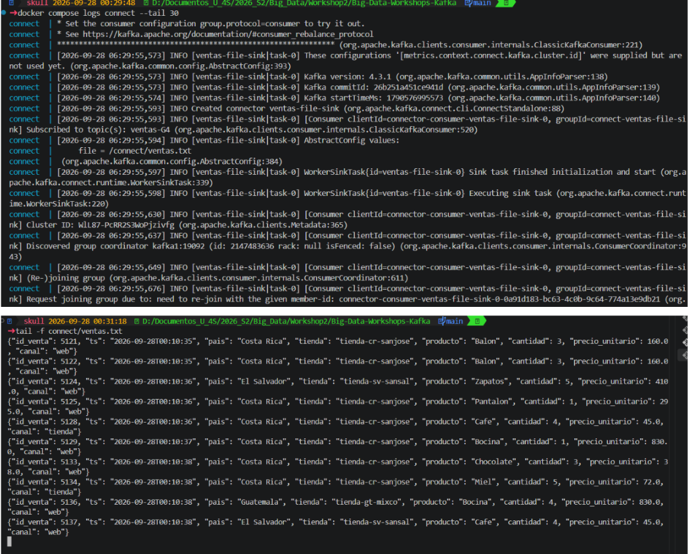

# Bitácora del taller de Kafka

- **Nombre:**  Hugo Jonathan Daniel Galina Puac
- **Carné:** 20240566
- **Grupo:** G#4
- **Enlace a tu video:** `video-demo.mp4` (en esta misma carpeta)

## 1. Evidencias

### E1. Los tres brokers y el detalle de tu topic (Pasos 6 y 7)



Lo que muestra: Los tres brokers con ids 11, 12 y 13 respondiendo en kafka-broker-api-versions.sh, y el --describe de ventas-G4 con 3 particiones, ReplicationFactor: 3 y min.insync.replicas=2, con las tres réplicas repartidas entre los tres brokers en cada partición.

### E2. La interfaz web con tu topic de ventas (Paso 8)



Lo que muestra: La interfaz web (kafbat UI) con el topic ventas-G4: 3 particiones, Replication Factor 3, In Sync Replicas 9 de 9 y 1115 mensajes acumulados en el topic.

### E3. Varios consumidores repartiéndose las particiones (Paso 8)



Lo que muestra: kafka-consumer-groups.sh --describe para el grupo 20240566-principal, con tres CONSUMER-ID distintos (uno por partición) y su LAG: 1, 13 y 4 mensajes pendientes de leer en cada una.

### E4. Falla de un broker (Paso 9)



Lo que muestra: Con kafka2 [confirma que fue kafka2, id 12] detenido, el --describe de ventas-G4 muestra el Isr con solo dos ids [11 y 13] en las particiones que tenían réplica en kafka2, y una de ellas con líder nuevo. El productor, en la otra terminal, sigue publicando sin errores.

### E5. Escrituras rechazadas (Paso 10)



Lo que muestra: El topic sin-copias con Leader: none en las particiones que estaban en los brokers detenidos, y el productor de ventas-G4 mostrando [!] NO se pudo enviar: KafkaTimeoutError tras detener también kafka3, con solo kafka1 activo.

### E6. Kafka Connect escribiendo el archivo (Paso 11)



Lo que muestra: Los logs de docker compose logs connect mostrando el conector ventas-file-sink creado y suscrito a ventas-G4, y tail -f connect/ventas.txt con eventos JSON (tienda, producto, cantidad, precio) escribiéndose en el archivo.

## 2. Preguntas

**1. ¿Qué guarda el controller y qué guarda cada broker? Justifícalo con lo que viste, y compáralo con el NameNode y los DataNodes del taller anterior.**

El controller lleva el inventario del clúster: qué topics existen, cuántas particiones tiene cada uno y quién es el líder de cada partición, pero no guarda ningún mensaje. Cada broker guarda los mensajes de las particiones que le tocan, en mi caso repartidas entre los ids 11, 12 y 13. Es la misma separación que el NameNode (metadatos, sin datos) y los DataNodes (los bloques reales) del taller de Hadoop.

**2. Con tu `--describe`: ¿cuántas particiones tiene tu topic, quién es líder de cada una y qué significa que el Isr tenga tres entradas?**

Mi topic ventas-G4 tiene 3 particiones (0, 1 y 2), con 3 copias cada una repartidas entre los brokers 11, 12 y 13 [copia aquí el líder exacto de cada partición desde tu --describe, por ejemplo "Partition 0 Leader 12"]. Que el Isr tenga tres entradas en cada partición significa que las tres copias, sin excepción, están al día con el líder; si alguna se atrasara, saldría de esa lista aunque el broker siguiera vivo.

**3. Produjiste con la tienda como clave. ¿Por qué una misma tienda cae siempre en la misma partición y qué garantía de orden te da eso? ¿Qué perderías si produjeras sin clave?**

Produje con la tienda como clave, y Kafka calcula la partición aplicando un hash a esa clave: la misma clave siempre da el mismo resultado, así que toda venta de una tienda cae en la misma partición. Como Kafka solo garantiza orden dentro de una partición, eso asegura que las ventas de una tienda lleguen en el orden en que se enviaron. Sin clave, Kafka reparte los mensajes en modo round-robin entre particiones, y se pierde esa garantía de orden por tienda.

**4. Corriste dos, tres y cuatro consumidores en el mismo grupo de lectura. ¿Qué pasó con el cuarto y por qué? ¿Qué cambió con un `--grupo-lectura` distinto?**

Con dos y tres consumidores en el grupo 20240566-principal, cada uno recibió una o más de las 3 particiones. Al entrar el cuarto, se quedó sin ninguna partición asignada, porque hay 3 particiones y un consumidor por partición como máximo dentro del mismo grupo; el cuarto queda ocioso hasta que otro salga. Con un --grupo-lectura distinto (auditoria), Kafka creó un group.id nuevo con sus propios offsets, y ese consumidor leyó todos los mensajes desde el principio, sin que le importara lo que ya había leído el grupo principal.

**5. Al detener brokers, en un caso el productor siguió y en otro falló. Explica por qué, y relaciona `acks` y `min.insync.replicas` con la C y la A del teorema CAP.**

Al detener kafka2, el Isr de ventas-G4 bajó de 3 a 2 [ajusta si fue otro broker], y como min.insync.replicas=2, ese mínimo se seguía cumpliendo: el productor continuó publicando sin errores. Al detener también kafka3, el Isr quedó en 1, y en el log de kafka1 apareció NotEnoughReplicas: The size of the current ISR : 1 is insufficient to satisfy the min.isr requirement of 2 for partition ventas-G4-0. Con acks="all", Kafka exige confirmación del Isr completo antes de aceptar una escritura; al no alcanzar el mínimo, la rechaza en vez de guardarla sin respaldo. Es elegir la C de CAP (consistencia: nunca confirmar un dato que no está replicado) sobre la A (disponibilidad: seguir aceptando escrituras aunque falten copias).

**6. Sacaste los datos a un archivo con tu consumidor y con Kafka Connect. ¿Qué tuviste que resolver para que Connect funcionara, y en qué caso real preferirías cada forma?**

Con mi propio consumidor (--guardar) no tuve que resolver nada adicional, porque ya tenía el cliente de Kafka hecho. Con Kafka Connect tuve que resolver tres cosas: apuntar a kafka1:19092 porque Connect corre dentro de Docker, usar StringConverter en vez del converter por defecto (que exige mensajes con schema y payload, y mi productor manda JSON plano), y apuntar plugin.path al JAR connect-file-4.3.1.jar [confirma el nombre exacto que te dio tu ls], porque Kafka 4 no lo carga solo. En un caso real usaría un programa propio cuando necesito transformar o filtrar los datos en el camino, y Kafka Connect cuando solo quiero mover datos de un topic a un destino ya soportado (un archivo, una base de datos), sin escribir ni mantener código para eso.

## 3. Mini-reto de tu grupo

**Pregunta asignada a tu grupo:**

Tratando cada evento como una venta, ¿cuál es el monto promedio (`cantidad × precio_unitario`) por canal, qué canal tiene el más alto y cuántas ventas tuvo cada canal?

**Tu programa** (también va como `mini-reto.py`):

```python
import json
from collections import defaultdict

total = defaultdict(float)   # suma de montos por canal
ventas = defaultdict(int)    # número de ventas por canal

for linea in open("salida/ventas-G4.jsonl", encoding="utf-8"):
    e = json.loads(linea)
    monto = e["cantidad"] * e["precio_unitario"]
    total[e["canal"]] += monto
    ventas[e["canal"]] += 1

promedios = {c: total[c] / ventas[c] for c in ventas}

for canal, prom in sorted(promedios.items(), key=lambda x: x[1], reverse=True):
    print(f"{canal:10} promedio {prom:,.2f}   ventas {ventas[canal]}")

print("Canal con el promedio más alto:", max(promedios, key=promedios.get))
```

**Resultado de tu programa** — la salida tal como la imprimió, y también la línea del `wc -l`:

```
2000 salida/ventas-G4.jsonl

tienda     promedio 2,485.20   ventas 302
web        promedio 1,974.06   ventas 1416
app        promedio 1,878.00   ventas 282
Canal con el promedio más alto: tienda
```

**Interpretación en una frase:**

Aunque el canal `web` concentra la mayoría de las ventas (1416 de 2000, el 70.8 %), el canal `tienda` genera el ticket promedio más alto (Q2,485.20), casi 26 % más que `web` y 32 % más que `app`, así que el volumen y el valor por venta no van de la mano en estos datos.

## 4. Problemas encontrados (opcional)

